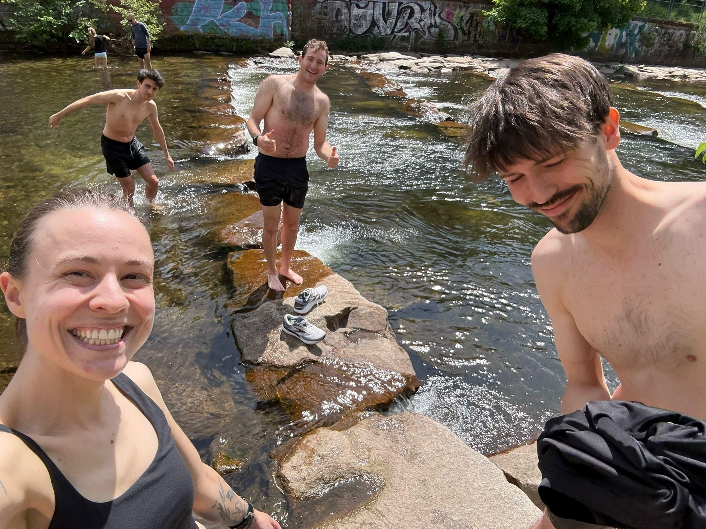

+++
title = "Remember the Curious George boats?"
description = "Run — 2026-05-03"
date = 2026-05-03
authors = ["Max Katz-Christy"]

[taxonomies]
tags = ["Run"]

[extra]
banner = "banner.jpg"
strava_id = 18358161102
distance_fmt = "9.11 km"
moving_time_fmt = "52m 14s"
elevation_gain_fmt = "67 m"
+++

Apparently that's an American thing. After lavender RC, went swimming in the dreisam and then walked in circles looking for a piano under a bridge. Right as we were gonna give up, we found it! 

Even Flixbus has a rear rack. Pretty sick. MTB and regular versions

## Stats

| | |
|---|---|
| **Distance** | 9.11 km |
| **Moving time** | 52m 14s |
| **Elapsed time** | 1h 29m 13s |
| **Elevation gain** | 67 m |
| **Average pace** | 5:43 /km |
| **Best pace** | 3:12 /km |
| **Average cadence** | 81 rpm |
| **Calories** | 772 kcal |
| **Device** | Garmin fēnix 6X |

## Route

{{ strava_map() }}

[View on Strava](https://www.strava.com/activities/18358161102)

## Photos

