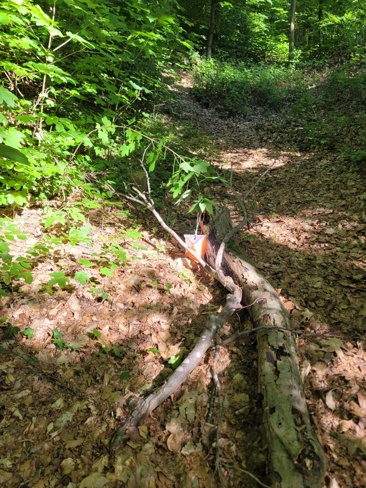

+++
title = "Orienteering!"
description = "TrailRun — 2026-05-22"
date = 2026-05-22
authors = ["Max Katz-Christy"]

[taxonomies]
tags = ["TrailRun"]

[extra]
banner = "banner.jpg"
strava_id = 18610594057
distance_fmt = "3.80 km"
moving_time_fmt = "26m 20s"
elevation_gain_fmt = "126 m"
+++

With Fabio and the Freiburg Club. Everything is going on a 2 week break and then starts back up again when I go to the US. Speaking of which... I'll be there on the 4th! Get ready for some last minute pasta dinners. Speaking of great food... Check out my summer mode tofu. Skip the air fryer. Almost the same great taste and way easier to make!

## Stats

| | |
|---|---|
| **Distance** | 3.80 km |
| **Moving time** | 26m 20s |
| **Elapsed time** | 42m 17s |
| **Elevation gain** | 126 m |
| **Average pace** | 6:55 /km |
| **Best pace** | 2:56 /km |
| **Average cadence** | 75 rpm |
| **Calories** | 445 kcal |
| **Device** | Garmin fēnix 6X |

## Route

{{ strava_map() }}

[View on Strava](https://www.strava.com/activities/18610594057)

## Photos

