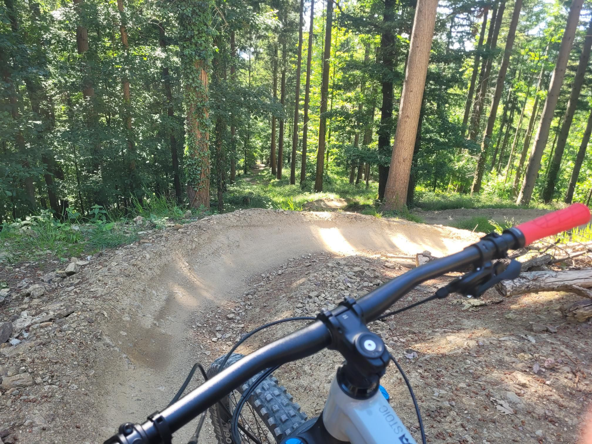

+++
title = "Trying to get the courage up to actually jump"
description = "MountainBikeRide — 2026-05-23"
date = 2026-05-23
authors = ["Max Katz-Christy"]

[taxonomies]
tags = ["MountainBikeRide"]

[extra]
banner = "banner.jpg"
strava_id = 18622382149
distance_fmt = "14.30 km"
moving_time_fmt = "1h 17m 20s"
elevation_gain_fmt = "384 m"
+++

Did some laps on the flowy section, while some guys on e-MTBs flew past me. Turns out my pedal was loose... Not sure if that was a coincidence or if I accidentally did that this morning when changing pedals on my other bike.

Strange to see Europeans playing American football. Not sure why they're always making fun of us for it.

## Stats

| | |
|---|---|
| **Distance** | 14.30 km |
| **Moving time** | 1h 17m 20s |
| **Elapsed time** | 1h 39m 46s |
| **Elevation gain** | 384 m |
| **Average speed** | 11.1 km/h |
| **Max speed** | 36.1 km/h |
| **Calories** | 697 kcal |
| **Achievements** | 17 |
| **Device** | Garmin fēnix 6X |

## Route

{{ strava_map() }}

[View on Strava](https://www.strava.com/activities/18622382149)

## Photos

