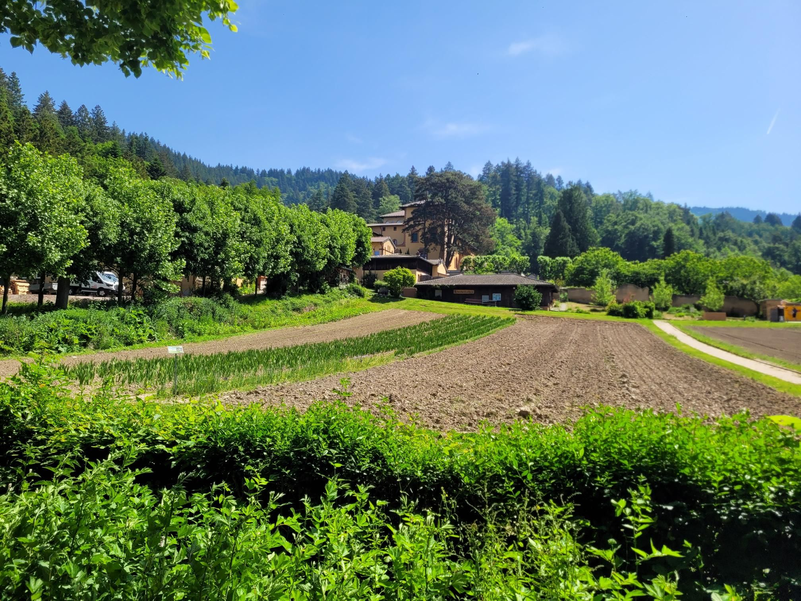

+++
title = "Running to Buch and Bücher über Bier"
description = "Run — 2026-05-24"
date = 2026-05-24
authors = ["Max Katz-Christy"]

[taxonomies]
tags = ["Run"]

[extra]
banner = "banner.jpg"
strava_id = 18638414833
distance_fmt = "8.29 km"
moving_time_fmt = "51m 07s"
elevation_gain_fmt = "86 m"
+++

And the ER, but not for me. Also not because of the run, but because of a tick from a few days ago.

It's getting real hot, but some ice cream and a swim in the river goes a long way.

## Stats

| | |
|---|---|
| **Distance** | 8.29 km |
| **Moving time** | 51m 07s |
| **Elapsed time** | 59m 25s |
| **Elevation gain** | 86 m |
| **Average pace** | 6:10 /km |
| **Best pace** | 2:10 /km |
| **Average cadence** | 80 rpm |
| **Calories** | 666 kcal |
| **Achievements** | 1 |
| **Device** | Garmin fēnix 6X |

## Route

{{ strava_map() }}

[View on Strava](https://www.strava.com/activities/18638414833)

## Photos

