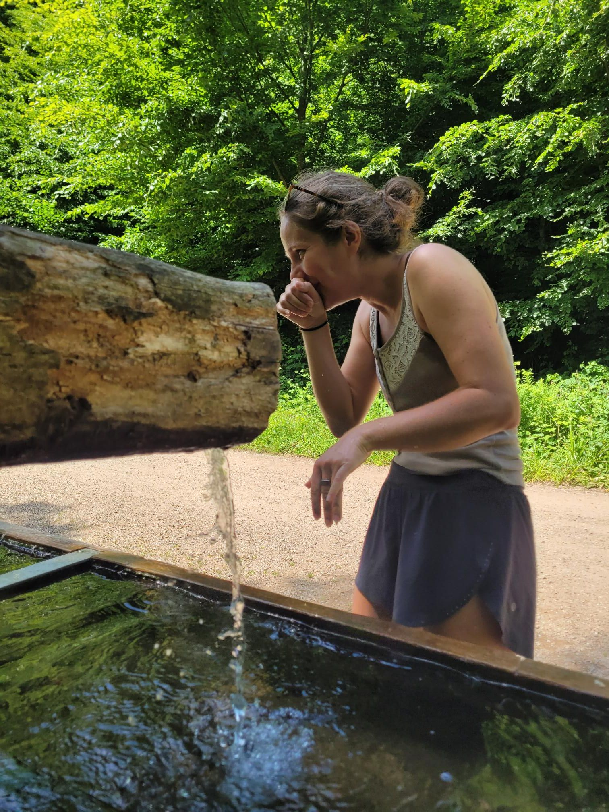

+++
title = "Giving the American a tour of Freiburg"
description = "Hike — 2026-05-25"
date = 2026-05-25
authors = ["Max Katz-Christy"]

[taxonomies]
tags = ["Hike"]

[extra]
banner = "banner.jpg"
strava_id = 18652717053
distance_fmt = "16.38 km"
moving_time_fmt = "3h 41m 56s"
elevation_gain_fmt = "1498 m"
+++

The American being Sarah Schaumann ... Sponsored by Scott's Hawaii

## Stats

| | |
|---|---|
| **Distance** | 16.38 km |
| **Moving time** | 3h 41m 56s |
| **Elapsed time** | 5h 43m 38s |
| **Elevation gain** | 1498 m |
| **Average pace** | 13:33 /km |
| **Best pace** | 4:06 /km |
| **Average cadence** | 54 rpm |
| **Calories** | 1437 kcal |
| **Achievements** | 1 |
| **Device** | Garmin fēnix 6X |

## Route

{{ strava_map() }}

[View on Strava](https://www.strava.com/activities/18652717053)

## Photos

