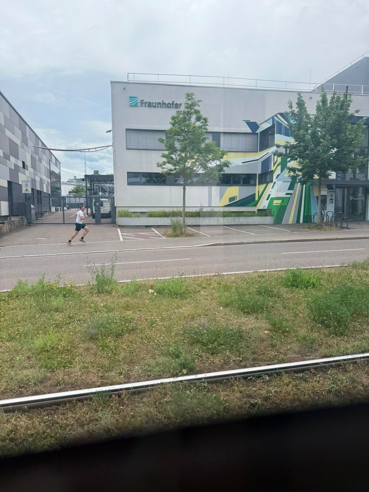

+++
title = "Gettin rolled by the 4 tram"
description = "Run — 2026-05-31"
date = 2026-05-31
authors = ["Max Katz-Christy"]

[taxonomies]
tags = ["Run"]

[extra]
banner = "banner.jpg"
strava_id = 18728369953
distance_fmt = "3.45 km"
moving_time_fmt = "15m 37s"
elevation_gain_fmt = "36 m"
+++

I'm just gonna have to be faster. I could see it make the first two turns but after that I was minutes behind. Guess I'm not as fast as all those influencers taping their phone to the tram.

While waiting for the tram to start, I saw a lizard and juggled some rocks. I wonder if cave man children also had wandering minds and whimsical lives

## Stats

| | |
|---|---|
| **Distance** | 3.45 km |
| **Moving time** | 15m 37s |
| **Elapsed time** | 15m 38s |
| **Elevation gain** | 36 m |
| **Average pace** | 4:31 /km |
| **Best pace** | 2:40 /km |
| **Average cadence** | 87 rpm |
| **Calories** | 241 kcal |
| **Device** | Garmin fēnix 6X |

## Route

{{ strava_map() }}

[View on Strava](https://www.strava.com/activities/18728369953)

## Photos

