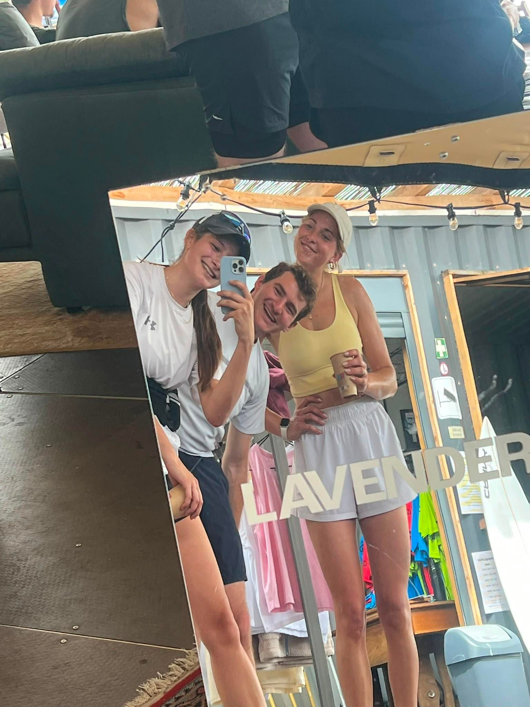

+++
title = "Lavender shakeoff run"
description = "Run — 2026-05-31"
date = 2026-05-31
authors = ["Max Katz-Christy"]

[taxonomies]
tags = ["Run"]

[extra]
banner = "banner.jpg"
strava_id = 18726460344
distance_fmt = "8.53 km"
moving_time_fmt = "50m 51s"
elevation_gain_fmt = "73 m"
+++

Gotta shakeoff my sore feet. I'm sweaty again. We ended up an interesting Surfpark thing. My phone is out of storage, so no pic, but you get the idea

## Stats

| | |
|---|---|
| **Distance** | 8.53 km |
| **Moving time** | 50m 51s |
| **Elapsed time** | 1h 47m 51s |
| **Elevation gain** | 73 m |
| **Average pace** | 5:57 /km |
| **Best pace** | 2:08 /km |
| **Average cadence** | 80 rpm |
| **Calories** | 846 kcal |
| **Achievements** | 1 |
| **Device** | Garmin fēnix 6X |

## Route

{{ strava_map() }}

[View on Strava](https://www.strava.com/activities/18726460344)

## Photos

