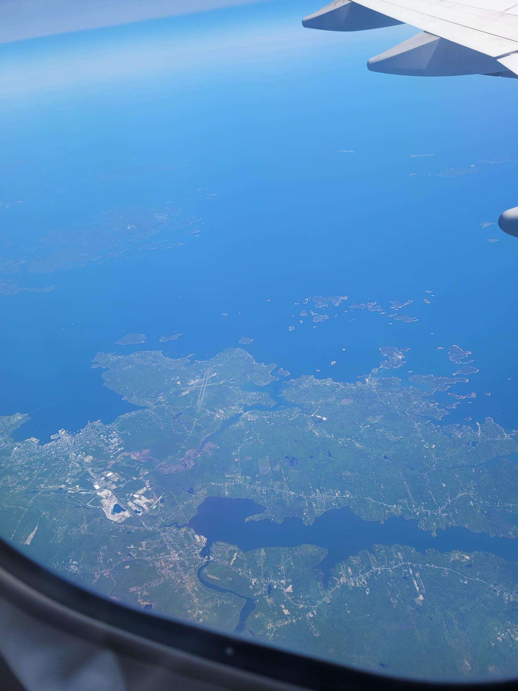

+++
title = "A very Boston welcome home"
description = "Hike — 2026-06-04"
date = 2026-06-04
authors = ["Max Katz-Christy"]

[taxonomies]
tags = ["Hike"]

[extra]
banner = "banner.jpg"
strava_id = 18791463661
distance_fmt = "0.91 mi"
moving_time_fmt = "8m 46s"
elevation_gain_fmt = "36 ft"
+++

Lufthansa was quite an experience. Leg room and decent food, as well as coming around 5 times for drinks, resulting in my consumption of a whopping 8 cups of tomato juice and befriending of the flight attendant. Even my rowmate, a nice "entrepreneur" fella from Bangalore, tried a cup.

Instead of going direct to Logan, we flew in a big wiggle up north, giving us some great views of Maine, the Cape, then back to the north shore. This may have been the cause of our quite late arrival in Boston. I caught the shuttle and ran down to the blue line train waiting on the tracks. I sort of recognized one of the people in my car but I couldn't figure out from where.

After the clown show of a couple singing along with their music and making some racist comments about the drivers accent bailed, Amelia said "you're from the transit lab, right?" Both headed to downtown and not wanting to wait forever for the stuck train, we remembered that they had just started running the ferry from the airport docks. On the way back to the shuttle I had just gotten off, we run into Chris, my coworker from Keolis who now works at Massport and who I planned to maybe see Friday!

It was a quick ferry hop to the North End where I attempted to rent a blue bike with my credit card (I have not renewed my US service plan). When this failed, I started hustling in my flip flops over the hill to the Longfellow bridge, picked up some meat for grilling at top shelf, and found Noah on the CBI dock. I begged for a ride across the river, which he had one of his minions grant.

And that's how I got back from the airport.

I took a class with Jim Aloisi with a final paper about how to improve getting from Kendall square to the airport. Maybe I should have thought more about the ferry. If it went through the locks into the river...

After team racing, grilling, and lots of chatting, I made my way home on one of the new red line cars. It's relaxing to be in a place where I speak the language. It's also very comforting to run into so many nice people that I know randomly unterwegs.

## Stats

| | |
|---|---|
| **Distance** | 0.91 mi |
| **Moving time** | 8m 46s |
| **Elapsed time** | 10m 54s |
| **Elevation gain** | 36 ft |
| **Average pace** | 9:35 /mi |

## Route

{{ strava_map() }}

[View on Strava](https://www.strava.com/activities/18791463661)

## Photos

