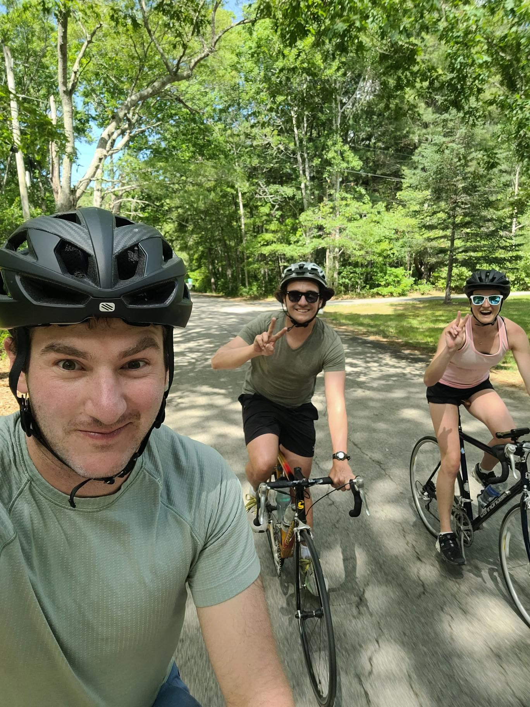

+++
title = "Poking a turtle across the road with a camp chair"
description = "Ride — 2026-06-07"
date = 2026-06-07
authors = ["Max Katz-Christy"]

[taxonomies]
tags = ["Ride"]

[extra]
banner = "banner.jpg"
strava_id = 18828327841
distance_fmt = "34.29 mi"
moving_time_fmt = "2h 56m 16s"
elevation_gain_fmt = "2231 ft"
+++

We came across two women trying to get the turtle to cross the road with a camp chair. We tried to help but probably only scared the turtle more. He was a big dude and he'd snap out and bite the chair if it was put in front of him.

I missed new England hills and roads. You can see the sandy dirt on the side of the road reminding you you're right near the coast at all times. It's nice to have some time away to appreciate it more.

If I haven't yet invited you, pump track tomorrow 9pm (Tuesday, not the date in the poster). Pull up!

## Stats

| | |
|---|---|
| **Distance** | 34.29 mi |
| **Moving time** | 2h 56m 16s |
| **Elapsed time** | 3h 28m 56s |
| **Elevation gain** | 2231 ft |
| **Average speed** | 11.7 mph |

## Route

{{ strava_map() }}

[View on Strava](https://www.strava.com/activities/18828327841)

## Photos

