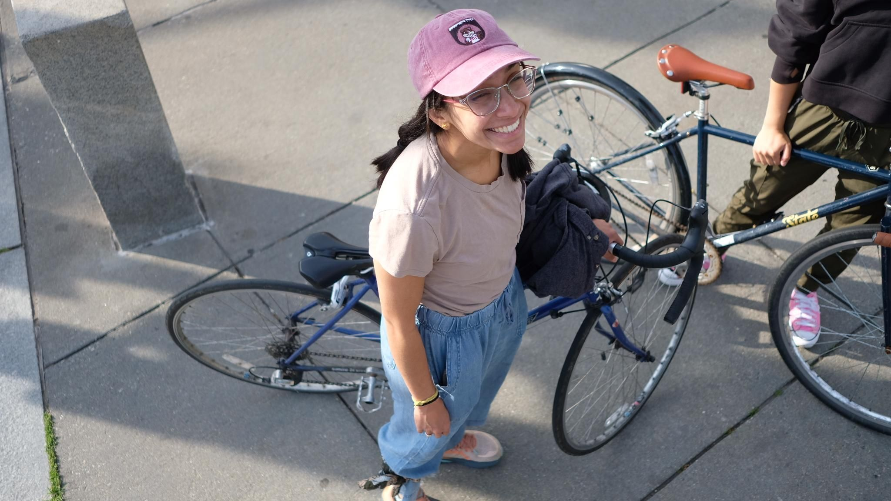

+++
title = "Some old faces, lots of new ones, and plenty of goofy ones"
description = "TrailRun — 2026-06-10"
date = 2026-06-10
authors = ["Max Katz-Christy"]

[taxonomies]
tags = ["TrailRun"]

[extra]
banner = "banner.jpg"
strava_id = 18872872127
distance_fmt = "6.99 mi"
moving_time_fmt = "1h 18m 32s"
elevation_gain_fmt = "889 ft"
+++

NTC pride run... I got a free pair of sunnies from Walton Rea! I'm sure they'll be used well until someone steps on them.

NTC is an always adjusting cult-like group of people and it's been fun to see it change over the years. However, it was what made me get into/like running.

Broke some early morning day old bread with these washed up kidos bright and early this morning. Maaya Prasad Grace Mao Daniel Klahn 

Yesterday delivered a boat to Marblehead and took the CR back. Got to go under and then over the train bridge 🚂

## Stats

| | |
|---|---|
| **Distance** | 6.99 mi |
| **Moving time** | 1h 18m 32s |
| **Elapsed time** | 1h 33m 21s |
| **Elevation gain** | 889 ft |
| **Average pace** | 11:14 /mi |

## Route

{{ strava_map() }}

[View on Strava](https://www.strava.com/activities/18872872127)

## Photos

