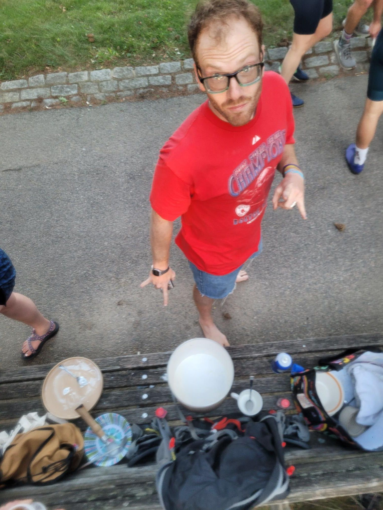

+++
title = "3 gallons of sugary lactose"
description = "Ride — 2026-06-17"
date = 2026-06-17
authors = ["Max Katz-Christy"]

[taxonomies]
tags = ["Ride"]

[extra]
banner = "banner.jpg"
strava_id = 18966061664
distance_fmt = "13.55 mi"
moving_time_fmt = "1h 06m 29s"
elevation_gain_fmt = "443 ft"
+++

Can you break lactose intolerance by eating a bunch of ice cream?

Thanks Ricky Salvatore for the invite. And the encouragement to stay until the end of the bucket. I should swim the mystic more 👍.

I do think Boston can be a lot like Freiburg with just a little bit of work (clean up the river, get rid of a bunch more cars)...

## Stats

| | |
|---|---|
| **Distance** | 13.55 mi |
| **Moving time** | 1h 06m 29s |
| **Elapsed time** | 2h 26m 50s |
| **Elevation gain** | 443 ft |
| **Average speed** | 12.2 mph |

## Route

{{ strava_map() }}

[View on Strava](https://www.strava.com/activities/18966061664)

## Photos

