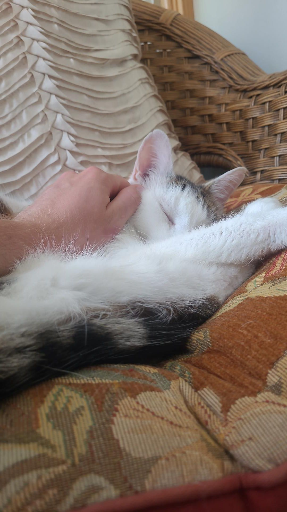

+++
title = "First visit to the Harvard General Store"
description = "Ride — 2026-06-27"
date = 2026-06-27
authors = ["Max Katz-Christy"]

[taxonomies]
tags = ["Ride"]

[extra]
banner = "banner.jpg"
strava_id = 19087218748
distance_fmt = "31.72 mi"
moving_time_fmt = "1h 59m 46s"
elevation_gain_fmt = "1667 ft"
+++

With the Williams boys (Matthew Goss and Co) and Felix Knollmann.

I think my watch auto saved while I was chowing down on a salt packet so here's some pics from the prior day.

## Stats

| | |
|---|---|
| **Distance** | 31.72 mi |
| **Moving time** | 1h 59m 46s |
| **Elapsed time** | 2h 02m 36s |
| **Elevation gain** | 1667 ft |
| **Average speed** | 15.9 mph |

## Route

{{ strava_map() }}

[View on Strava](https://www.strava.com/activities/19087218748)

## Photos

