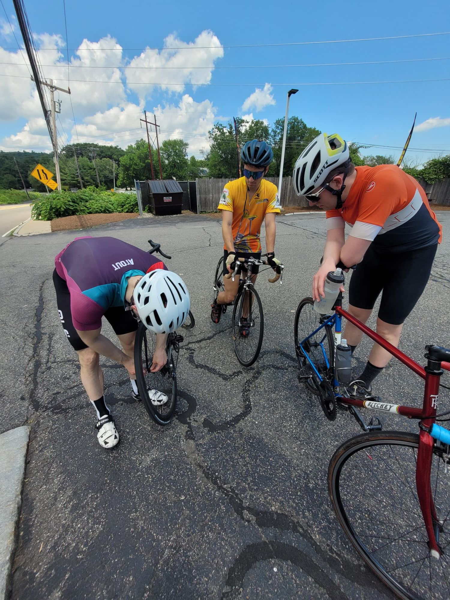

+++
title = "Riding a bike is not like riding a bike"
description = "Ride — 2026-06-27"
date = 2026-06-27
authors = ["Max Katz-Christy"]

[taxonomies]
tags = ["Ride"]

[extra]
banner = "banner.jpg"
strava_id = 19088978174
distance_fmt = "32.50 mi"
moving_time_fmt = "2h 12m 36s"
elevation_gain_fmt = "1585 ft"
+++

Turns out you have to practice to keep the muscles there. Maybe even going to the gym helps. All I know is that a year of not doing much biking or gym does not make it easy to chase Matthew Goss and Felix Knollmann up hills. Thanks for the pulls, patience, and parking at the top of the hills. I stretched a little to get the last p. Apparently if you list things in 3s it makes it seem AI generated... Do you think this is AI generated? Maybe I've been generating my Strava this whole time... Was I ever even in Germany?

That's Felix wrapping his broken spoke around another so he doesn't lose a nipple into his rim and have to spend days shaking the thing out.

## Stats

| | |
|---|---|
| **Distance** | 32.50 mi |
| **Moving time** | 2h 12m 36s |
| **Elapsed time** | 2h 30m 41s |
| **Elevation gain** | 1585 ft |
| **Average speed** | 14.7 mph |

## Route

{{ strava_map() }}

[View on Strava](https://www.strava.com/activities/19088978174)

## Photos

