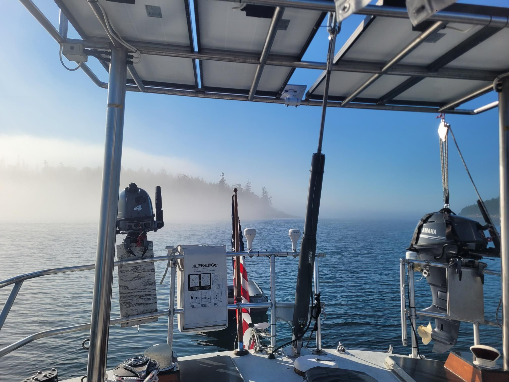

+++
title = "Learning a lot through someone's trash"
description = "Hike — 2026-06-30"
date = 2026-06-30
authors = ["Max Katz-Christy"]

[taxonomies]
tags = ["Hike"]

[extra]
banner = "banner.jpg"
strava_id = 19129201235
distance_fmt = "1.26 mi"
moving_time_fmt = "43m 20s"
elevation_gain_fmt = "180 ft"
+++

With the Rozalia Project, we sailed from Bar Harbor to Marshall Island and spent a couple days dropping by different beaches and pickup up lots of trash. A significant portion was lobster gear, and through learning how to classify the different objects I learned quite a bit about lobstering.

Tldr we collected all the bait fish so now they are reliant on the bait in the traps. The traps have vents that let them out when they are small. When they get big enough they can no longer get through the vent. 

If I hadn't stopped eating lobster because of the price, this might have gotten me.

Apparently they have traps 15 miles out where it's 400 ft deep. Maybe it's time for some tofu. It tastes much better raw than raw lobster.

More pics will come soon from other people's cameras.

## Stats

| | |
|---|---|
| **Distance** | 1.26 mi |
| **Moving time** | 43m 20s |
| **Elapsed time** | 1h 29m 27s |
| **Elevation gain** | 180 ft |
| **Average pace** | 34:20 /mi |

## Route

{{ strava_map() }}

[View on Strava](https://www.strava.com/activities/19129201235)

## Photos

