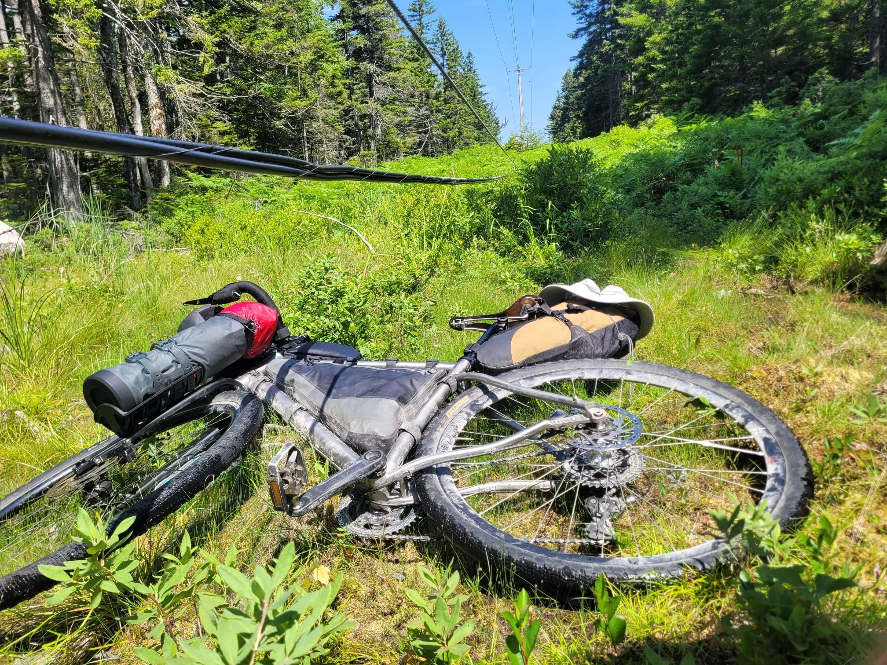

+++
title = "Optimism + Sunk Cost Fallacy = Underbiking"
description = "GravelRide — 2026-07-02"
date = 2026-07-02
authors = ["Max Katz-Christy"]

[taxonomies]
tags = ["GravelRide"]

[extra]
banner = "banner.jpg"
strava_id = 19155536489
distance_fmt = "76.87 mi"
moving_time_fmt = "7h 36m 01s"
elevation_gain_fmt = "3799 ft"
+++

There was a nice two track into the woods under some power lines, so I figured it was simply a continuation of the bike trail. It slowly decayed to where I was knee deep in mud that tried to eat my flip flops, bushes high enough to scratch my elbows, and power lines hanging low enough I had to crawl under them.

After surviving the hour of bikewhacking, I learned that I could get a ride from someone in Ellsworth in 3 hours, but I was only 2.5 away on the "best route". The fastest route took rt 1, but I went inland a little ways to the down east sunrise trail (which I've seen on maps but never gotten to ride). Unfortunately, the trail is not made for bikes. The thick layer of sand and large gravel gives almost no grip even on my wide tires. It was also not particular shady. It was HOT. However, I was on a bit of a time constraint so I just had to keep pushing.

Big day for water. I didn't need to do this hard of a ride. The ride to the top of the schoodic head was pretty but definitely unnecessary. Habits die hard

## Stats

| | |
|---|---|
| **Distance** | 76.87 mi |
| **Moving time** | 7h 36m 01s |
| **Elapsed time** | 8h 59m 38s |
| **Elevation gain** | 3799 ft |
| **Average speed** | 10.1 mph |

## Route

{{ strava_map() }}

[View on Strava](https://www.strava.com/activities/19155536489)

## Photos

