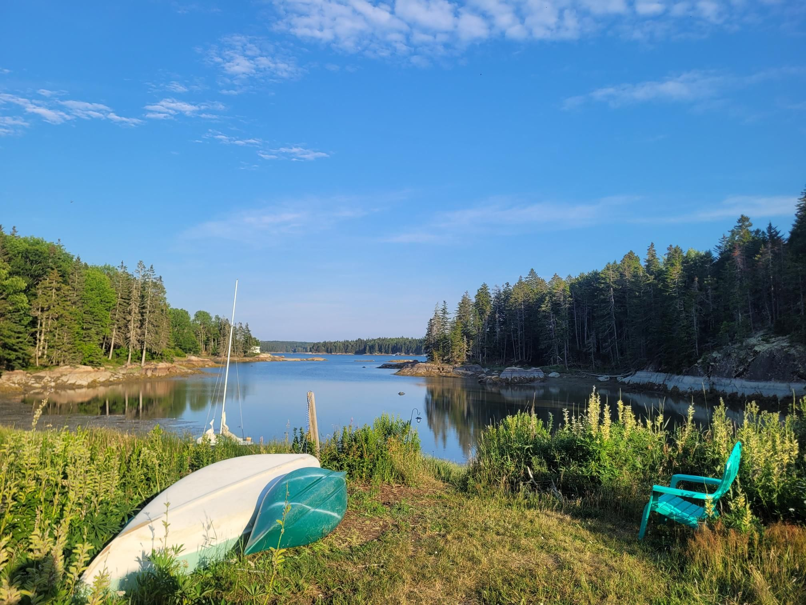

+++
title = "KC Canoeing"
description = "Canoeing — 2026-07-04"
date = 2026-07-04
authors = ["Max Katz-Christy"]

[taxonomies]
tags = ["Canoeing"]

[extra]
banner = "banner.jpg"
strava_id = 19183032745
distance_fmt = "1.59 mi"
moving_time_fmt = "36m 54s"
elevation_gain_fmt = "20 ft"
+++

Nina taught me and Mo a bit about how to paddle properly from her dragon boat expertise, while also criticizing my steering as we went for a little paddle.

We attempted to catch the West Bus from Ellsworth earlier in the day but failed... My theory is that it went to the stop early (we were there, but hiding in the shade around the corner). However, our reroute to Mo's friends place here was not the worst turn of events.

Would be cool if I actually knew how to play banjo... Maybe I'll learn the basics here.

## Stats

| | |
|---|---|
| **Distance** | 1.59 mi |
| **Moving time** | 36m 54s |
| **Elapsed time** | 55m 50s |
| **Elevation gain** | 20 ft |
| **Average speed** | 2.6 mph |

## Route

{{ strava_map() }}

[View on Strava](https://www.strava.com/activities/19183032745)

## Photos

