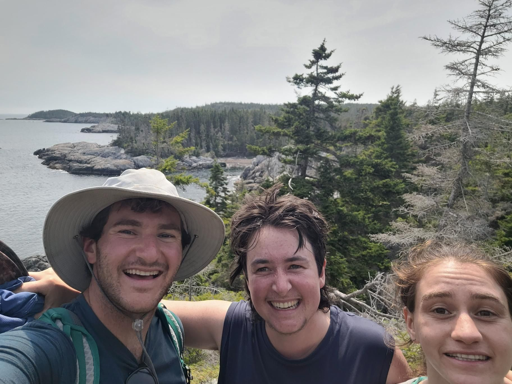

+++
title = "Liberal Lobstermen"
description = "Hike — 2026-07-06"
date = 2026-07-06
authors = ["Max Katz-Christy"]

[taxonomies]
tags = ["Hike"]

[extra]
banner = "banner.jpg"
strava_id = 19205971342
distance_fmt = "8.65 mi"
moving_time_fmt = "4h 22m 00s"
elevation_gain_fmt = "1640 ft"
+++

When I went to bar harbor a week ago, I didn't know that this part of Acadia even existed. In the last week or so, I've gotten to visit all three of them!

This one has been my favorite. Partially because it's harder to access... So 🤫. We saw maybe 10 people on the hike all day. There's been incredible rock skipping for me, lots of seaweed for Mo, and the camping is civilized enough for Nina.

Last night, we were invited to a bonfire with Mo's friend and some other locals. Met some of the island lobstermen and some carpenters. I felt very small. It was intimidating. Maybe that's my next career, apparently it's not too hard to find a job on a boat.

## Stats

| | |
|---|---|
| **Distance** | 8.65 mi |
| **Moving time** | 4h 22m 00s |
| **Elapsed time** | 6h 31m 59s |
| **Elevation gain** | 1640 ft |
| **Average pace** | 30:16 /mi |

## Route

{{ strava_map() }}

[View on Strava](https://www.strava.com/activities/19205971342)

## Photos

