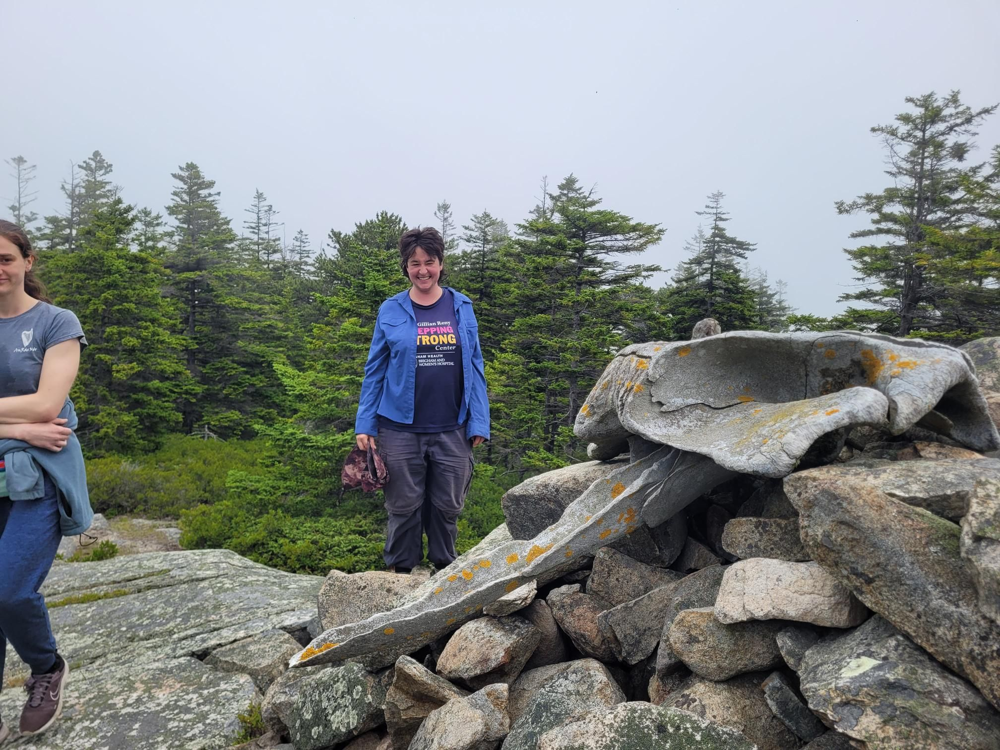

+++
title = "Town trails v NPS trails"
description = "Hike — 2026-07-07"
date = 2026-07-07
authors = ["Max Katz-Christy"]

[taxonomies]
tags = ["Hike"]

[extra]
banner = "banner.jpg"
strava_id = 19220858287
distance_fmt = "9.16 mi"
moving_time_fmt = "4h 14m 39s"
elevation_gain_fmt = "2198 ft"
+++

Similarly unmaintained. Bagged all the 500 footers on the island I think. Headed back to the "bridged island" of deer Isle!

## Stats

| | |
|---|---|
| **Distance** | 9.16 mi |
| **Moving time** | 4h 14m 39s |
| **Elapsed time** | 5h 52m 01s |
| **Elevation gain** | 2198 ft |
| **Average pace** | 27:47 /mi |

## Route

{{ strava_map() }}

[View on Strava](https://www.strava.com/activities/19220858287)

## Photos

