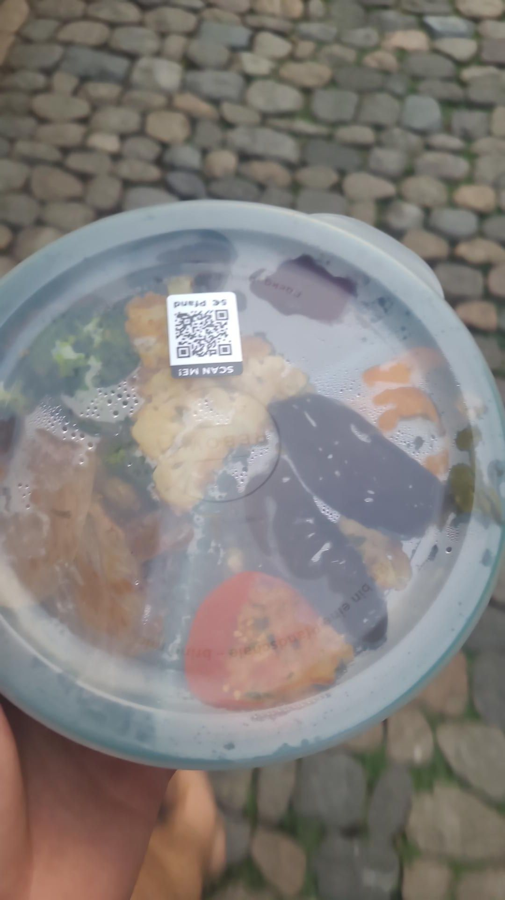

+++
title = "Community Chillers"
description = "TrailRun — 2026-07-15"
date = 2026-07-15
authors = ["Max Katz-Christy"]

[taxonomies]
tags = ["TrailRun"]

[extra]
banner = "banner.jpg"
strava_id = 19326827528
distance_fmt = "7.58 mi"
moving_time_fmt = "1h 19m 15s"
elevation_gain_fmt = "1886 ft"
+++

Community trail run canceled because of the weather, so only the chillers showed up. Nice group of four to the top of Rosskopf. Honestly beautiful weather. Good to be back! Can't wait to go eat some berries...

## Stats

| | |
|---|---|
| **Distance** | 7.58 mi |
| **Moving time** | 1h 19m 15s |
| **Elapsed time** | 1h 38m 58s |
| **Elevation gain** | 1886 ft |
| **Average pace** | 10:27 /mi |

## Route

{{ strava_map() }}

[View on Strava](https://www.strava.com/activities/19326827528)

## Photos

