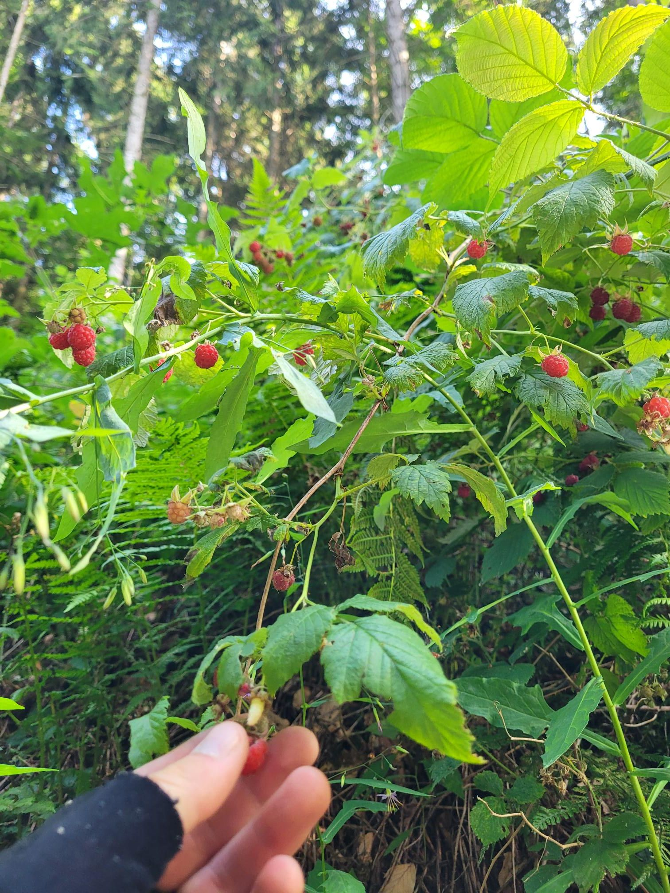

+++
title = "My heart racing at 60 berries per minute (bpm)"
description = "MountainBikeRide — 2026-07-19"
date = 2026-07-19
authors = ["Max Katz-Christy"]

[taxonomies]
tags = ["MountainBikeRide"]

[extra]
banner = "banner.jpg"
strava_id = 19380756226
distance_fmt = "21.84 mi"
moving_time_fmt = "3h 23m 52s"
elevation_gain_fmt = "4259 ft"
+++

Went to Schauinsland the other way this time. Made it to my tgtg just in time. I always think I have tons of time. But then I saw all the berries, and I couldn't get anywhere.

I was going to try to see the longboarders going down from the top but I didn't feel like waiting around so long.

I think I'm starting to figure out berms! I'm still really bad at downhill.

## Stats

| | |
|---|---|
| **Distance** | 21.84 mi |
| **Moving time** | 3h 23m 52s |
| **Elapsed time** | 4h 33m 42s |
| **Elevation gain** | 4259 ft |
| **Average speed** | 6.4 mph |

## Route

{{ strava_map() }}

[View on Strava](https://www.strava.com/activities/19380756226)

## Photos

