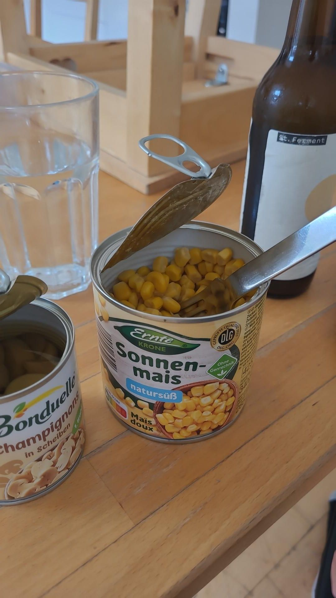

+++
title = "When you forget to go shopping on Saturday"
description = "Run — 2026-07-19"
date = 2026-07-19
authors = ["Max Katz-Christy"]

[taxonomies]
tags = ["Run"]

[extra]
banner = "banner.jpg"
strava_id = 19374933470
distance_fmt = "5.07 mi"
moving_time_fmt = "48m 32s"
elevation_gain_fmt = "141 ft"
+++

And everything is closed on Sunday. I still gotta get a new brake for my roller blades. Hopefully Decathlon sells them.

## Stats

| | |
|---|---|
| **Distance** | 5.07 mi |
| **Moving time** | 48m 32s |
| **Elapsed time** | 1h 00m 30s |
| **Elevation gain** | 141 ft |
| **Average pace** | 9:34 /mi |

## Route

{{ strava_map() }}

[View on Strava](https://www.strava.com/activities/19374933470)

## Photos

