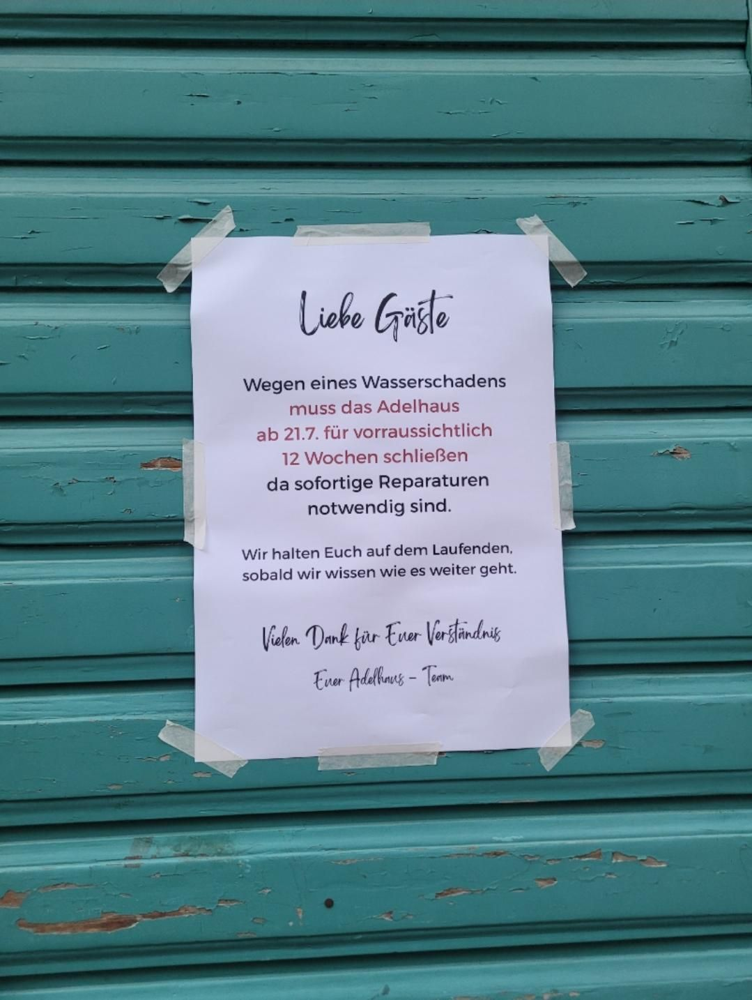

+++
title = "Runnin with the Italians"
description = "TrailRun — 2026-07-22"
date = 2026-07-22
authors = ["Max Katz-Christy"]

[taxonomies]
tags = ["TrailRun"]

[extra]
banner = "banner.jpg"
strava_id = 19423129049
distance_fmt = "6.48 mi"
moving_time_fmt = "1h 09m 00s"
elevation_gain_fmt = "748 ft"
+++

Freiburg needs more runs that end at a social spot. Also rip my favorite tgtg... Closed for a few weeks

## Stats

| | |
|---|---|
| **Distance** | 6.48 mi |
| **Moving time** | 1h 09m 00s |
| **Elapsed time** | 1h 09m 04s |
| **Elevation gain** | 748 ft |
| **Average pace** | 10:39 /mi |

## Route

{{ strava_map() }}

[View on Strava](https://www.strava.com/activities/19423129049)

## Photos

