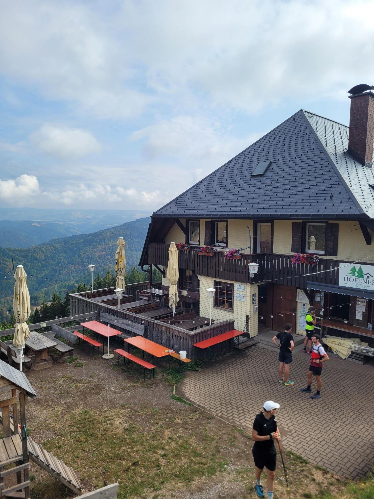

+++
title = "Not keen on keens"
description = "Run — 2026-08-01"
date = 2026-08-01
authors = ["Max Katz-Christy"]

[taxonomies]
tags = ["Run"]

[extra]
banner = "banner.jpg"
strava_id = 19555870929
distance_fmt = "20.52 mi"
moving_time_fmt = "5h 10m 03s"
elevation_gain_fmt = "4951 ft"
+++

I set out this morning intending to bike to the start of a 19k run. Then I learned they were 3 runs (19, 33, and 52). So obviously I was curious about the 52. Keen was there offering shoes to try out, so on my way out I tossed one of those buggers on.

It was extremely hot and humid. Very nice running group, though. I thought the heat would be my demise. Then my heel started rubbing itself to bits. Hi Mynameisdave taught me a trick to tighten the shoe in a way that keeps it more off the heel. This mediated the rubbing significantly.

Neither of these were what got me. On the first downhill I got excited and started going fast. I slammed down on the outside of my foot, and stumbled the rest of the downhill. It lasted another 20 or so kilometers before starting to swell and making the downhills way too brutal.

I left the group to walk the direct route back, but after scrambling over a recently downed tree I bailed out to the bus and took that back to my shoes.

## Stats

| | |
|---|---|
| **Distance** | 20.52 mi |
| **Moving time** | 5h 10m 03s |
| **Elapsed time** | 5h 35m 53s |
| **Elevation gain** | 4951 ft |
| **Average pace** | 15:06 /mi |

## Route

{{ strava_map() }}

[View on Strava](https://www.strava.com/activities/19555870929)

## Photos

