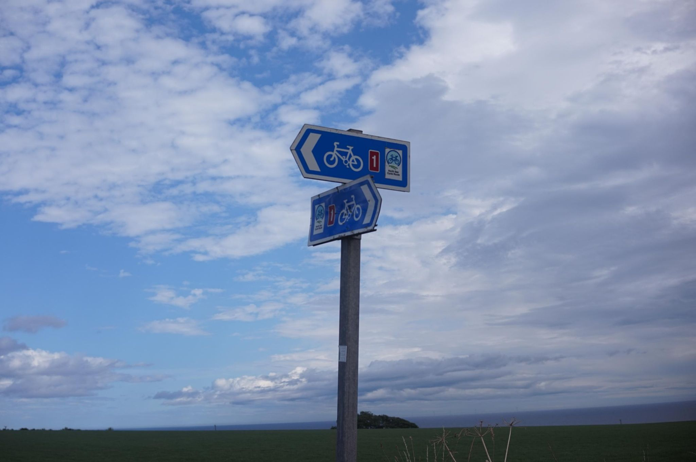

+++
title = "The Curse of Aberdeen lives on"
description = "Ride — 2026-08-09"
date = 2026-08-09
authors = ["Max Katz-Christy"]

[taxonomies]
tags = ["Ride"]

[extra]
banner = "banner.jpg"
strava_id = 19672549240
distance_fmt = "20.92 mi"
moving_time_fmt = "2h 22m 38s"
elevation_gain_fmt = "1358 ft"
+++

Nina Katz-Christy and I used to get lost a lot. We didn't have phones so we'd wander and argue until we reached our destination. For some reason, multiple times before we got lost, we saw an Aberdeen street (there are many in Camberville).

Today, I got a flat on my Brompton, on the way to Aberdeen. It was in the rear, which I had noticed was already balding. I did not bring a wrench or tire irons, despite having a patch kit and allen keys. I'm not sure what exactly I was planning to do with this combination, but it made me feel prepared. I quickly made a plan with Owen and Claire that I would go to the bus stop and fix it in Aberdeen before the shops closed. I made the bus by a few minutes and the shop by twenty. Fortunately, all British shops seem to be well aquatinted with the Brompton, so I ended up with the cool tool kit that fits inside the tube, and a new tube and tire.

In front of a church, I got to work, following the British ladies instructions for how to completely disassemble the rear to extract the wheel. As I was putting it back together, a man with "my name is Willie" pulled up with his bike and big delivery pack, curious what I was doing. We exchanged a couple stories about touring and then he asked about my camera, clearly wanting to tell me about his work collecting zines for the Aberdeen zine library and posting it online.

I biked back down bike route 1 towards Owen and Claire, and we then settled down in the tent where I am now. Here on this cliff we've been able to see dolphins and play a card version of Catan in the tent.

## Stats

| | |
|---|---|
| **Distance** | 20.92 mi |
| **Moving time** | 2h 22m 38s |
| **Elapsed time** | 6h 30m 50s |
| **Elevation gain** | 1358 ft |
| **Average speed** | 8.8 mph |

## Route

{{ strava_map() }}

[View on Strava](https://www.strava.com/activities/19672549240)

## Photos

