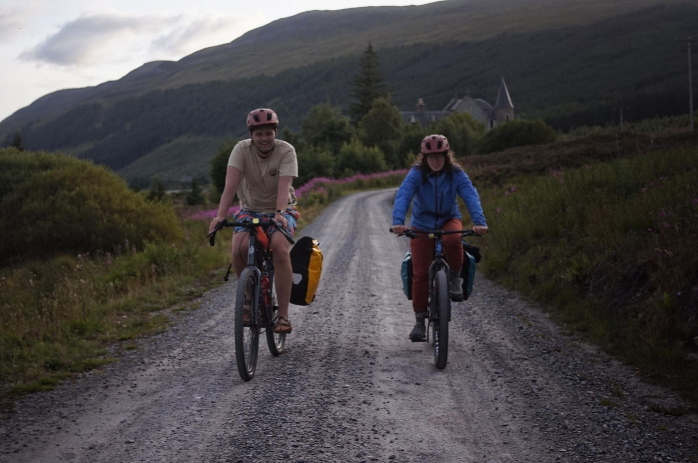

+++
title = "What's worse: midges or mosquitos"
description = "Ride — 2026-08-10"
date = 2026-08-10
authors = ["Max Katz-Christy"]

[taxonomies]
tags = ["Ride"]

[extra]
banner = "banner.jpg"
strava_id = 19686711579
distance_fmt = "31.48 mi"
moving_time_fmt = "3h 27m 23s"
elevation_gain_fmt = "1516 ft"
+++

After getting off the train and spending maybe two hours doing some "quick shopping" in Aviemore, we exited the outdoorsy town onto some small roads and trails along the spey. Still gotta look up what a spey is.

We made it back to Dahlwinnie, where I was two years ago, when I spent the summer in Europe on the rail pass. I didn't expect to come back here, but now we're camped out at the end of the lake I biked around. Very cool to recognize things from then and think about how much has changed in my life since.

We ate dinner on top of the dam, which went from relaxed to frantic as the midges swarmed us and round two of pasta. Many flew a little too close to the pasta, resulting in what too closely resembled pepper. I hope there's a breeze in the morning.

## Stats

| | |
|---|---|
| **Distance** | 31.48 mi |
| **Moving time** | 3h 27m 23s |
| **Elapsed time** | 4h 55m 33s |
| **Elevation gain** | 1516 ft |
| **Average speed** | 9.1 mph |

## Route

{{ strava_map() }}

[View on Strava](https://www.strava.com/activities/19686711579)

## Photos

