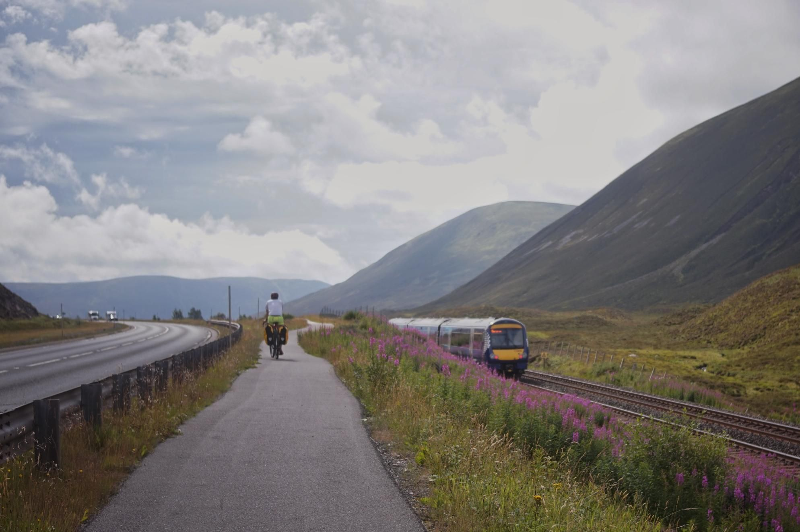

+++
title = "Rolling out of the highlands"
description = "Ride — 2026-08-11"
date = 2026-08-11
authors = ["Max Katz-Christy"]

[taxonomies]
tags = ["Ride"]

[extra]
banner = "banner.jpg"
strava_id = 19701417037
distance_fmt = "64.97 mi"
moving_time_fmt = "6h 44m 05s"
elevation_gain_fmt = "2490 ft"
+++

We woke up in Dahlwhinnie, and during breakfast, managed to engage about 2/4 of the commercial establishments of the town (missed the gas station and hostel, made it to the cafe and distillery).

Soon, we were on familiar roads, giving little bits of déjà-vu, ending up right outside a pie shop that I vividly remember getting pie from two years ago with Daren before racing to the station.

This time we went past Pitlochry to Perth. For a small town, it has a very large number of game stores, international supermarkets, and barber shops. I did try to get a haircut, but the only barber shop (which is also half game store) did not take walk ins.

I notice a man who looks almost like he works for Scotrail at the station as I'm trying to get some fun pictures of Scotlands funny little DMU's. The guy points me to the right platform, and I learn that he's just a train enthusiast. We didn't have much time to chat, but after saying some things in an accent too thick for me to understand past 5pm, points out the best seat for the views on my way to Edinburgh.

My train is empty but my day has been full. It's been a wonderful adventure with Claire Lynch and Owen and I'm looking forward to a bed and exploring The Fringe tomorrow.

## Stats

| | |
|---|---|
| **Distance** | 64.97 mi |
| **Moving time** | 6h 44m 05s |
| **Elapsed time** | 10h 28m 10s |
| **Elevation gain** | 2490 ft |
| **Average speed** | 9.6 mph |

## Route

{{ strava_map() }}

[View on Strava](https://www.strava.com/activities/19701417037)

## Photos

