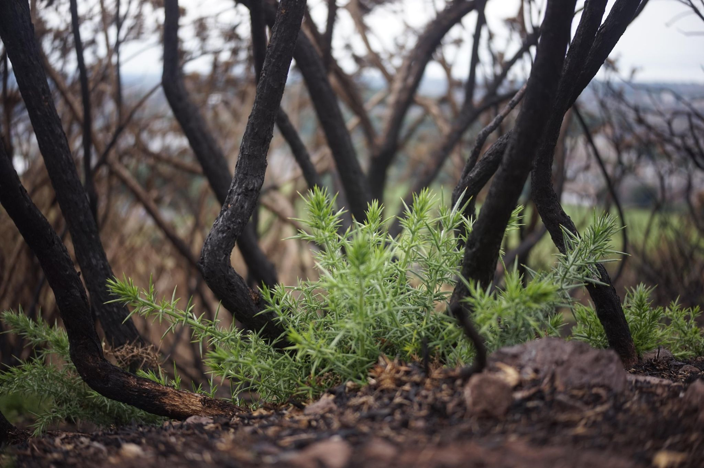

+++
title = "Too good to go, not too charred to grow"
description = "Hike — 2026-08-13"
date = 2026-08-13
authors = ["Max Katz-Christy"]

[taxonomies]
tags = ["Hike"]

[extra]
banner = "banner.jpg"
strava_id = 19727775376
distance_fmt = "4.98 mi"
moving_time_fmt = "2h 03m 36s"
elevation_gain_fmt = "1276 ft"
+++

I'm here in Edinburgh during "the fringe" which is fun, but it can be a lot. So, instead, I did what I usually do: walk all around the city, picking up too good to goes, stopping at the barber, and hiking to the highest points. I also had an alcohol free Guinness at a bar while I waited for my phone to charge. Not as good as the real one.

During a quick rain, I managed to share some too good to go with a uni kid at the pump track. Little bits of rain are like train delays, a small inconvenience that brings people together.

Headed to Birmingham tonight! Then back home (probably, still gotta book the seat for Sunday).

## Stats

| | |
|---|---|
| **Distance** | 4.98 mi |
| **Moving time** | 2h 03m 36s |
| **Elapsed time** | 2h 55m 23s |
| **Elevation gain** | 1276 ft |
| **Average pace** | 24:50 /mi |

## Route

{{ strava_map() }}

[View on Strava](https://www.strava.com/activities/19727775376)

## Photos

