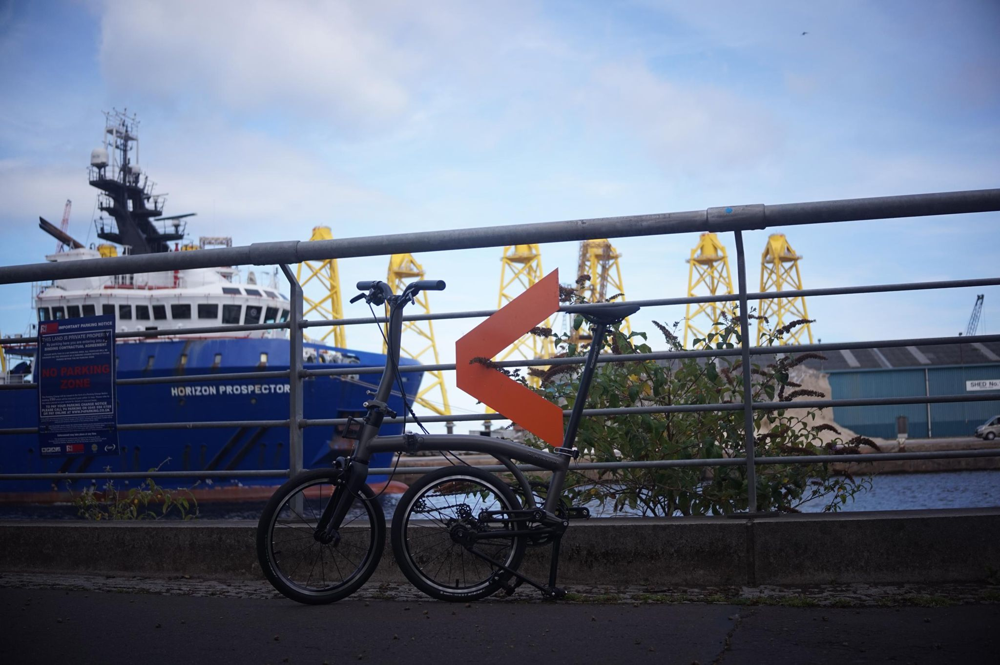

+++
title = "Foldy swap"
description = "Ride — 2026-08-14"
date = 2026-08-14
authors = ["Max Katz-Christy"]

[taxonomies]
tags = ["Ride"]

[extra]
banner = "banner.jpg"
strava_id = 19741063457
distance_fmt = "14.38 mi"
moving_time_fmt = "1h 47m 38s"
elevation_gain_fmt = "843 ft"
+++

Trying out the knockoff Brompton. Verdict? Competition is good. Brompton could afford to innovate a little. The Brompton is still a tried and true powerhouse. Also, it's a cult, and a kinda funny one. Chatted with this guy who called out "Brompton!" as I went past.

## Stats

| | |
|---|---|
| **Distance** | 14.38 mi |
| **Moving time** | 1h 47m 38s |
| **Elapsed time** | 4h 50m 08s |
| **Elevation gain** | 843 ft |
| **Average speed** | 8.0 mph |

## Route

{{ strava_map() }}

[View on Strava](https://www.strava.com/activities/19741063457)

## Photos

