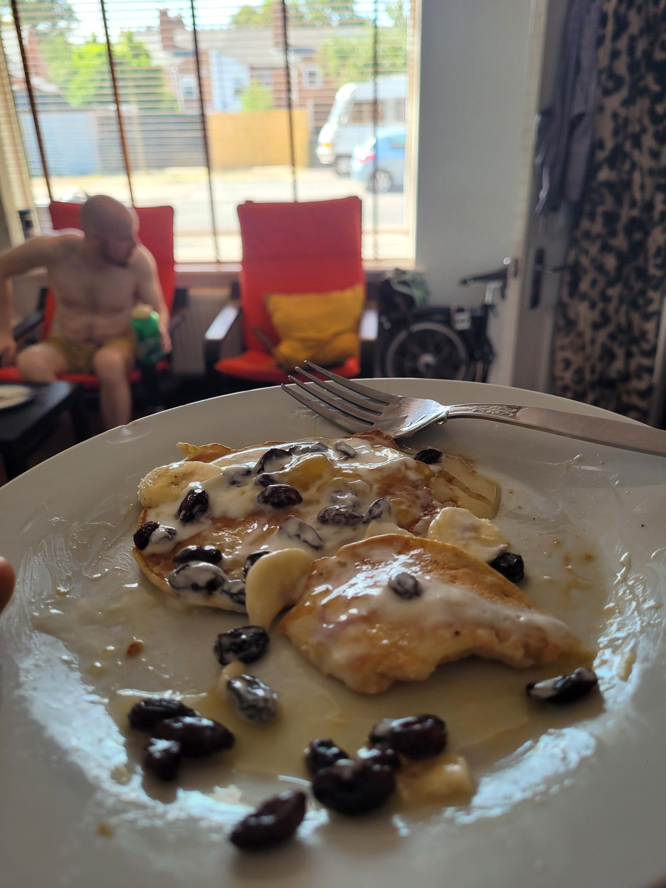

+++
title = "It's wedding time"
description = "Ride — 2026-08-14"
date = 2026-08-14
authors = ["Max Katz-Christy"]

[taxonomies]
tags = ["Ride"]

[extra]
banner = "banner.jpg"
strava_id = 19744975550
distance_fmt = "4.10 mi"
moving_time_fmt = "29m 20s"
elevation_gain_fmt = "256 ft"
+++

And this is what I've been carrying around a suit for

## Stats

| | |
|---|---|
| **Distance** | 4.10 mi |
| **Moving time** | 29m 20s |
| **Elapsed time** | 30m 58s |
| **Elevation gain** | 256 ft |
| **Average speed** | 8.4 mph |

## Route

{{ strava_map() }}

[View on Strava](https://www.strava.com/activities/19744975550)

## Photos

