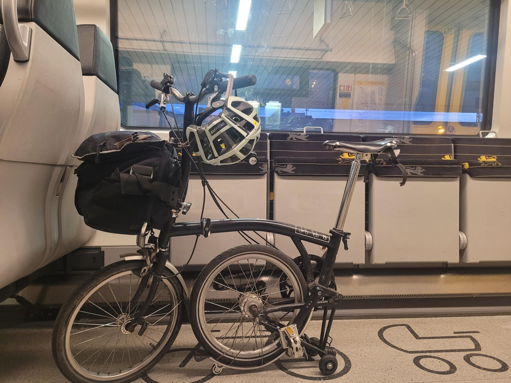

+++
title = "Missed the Eurostar, got some cookies"
description = "Ride — 2026-08-16"
date = 2026-08-16
authors = ["Max Katz-Christy"]

[taxonomies]
tags = ["Ride"]

[extra]
banner = "banner.jpg"
strava_id = 19771470270
distance_fmt = "1.85 mi"
moving_time_fmt = "11m 08s"
elevation_gain_fmt = "16 ft"
+++

I misread my Eurostar departure time and while I waited, got myself some tgtg cookies. Then decided to avoid the construction north of Freiburg by going through Basel and doing the basel station hop on the brompton

## Stats

| | |
|---|---|
| **Distance** | 1.85 mi |
| **Moving time** | 11m 08s |
| **Elapsed time** | 11m 47s |
| **Elevation gain** | 16 ft |
| **Average speed** | 10.0 mph |

## Route

{{ strava_map() }}

[View on Strava](https://www.strava.com/activities/19771470270)

## Photos

