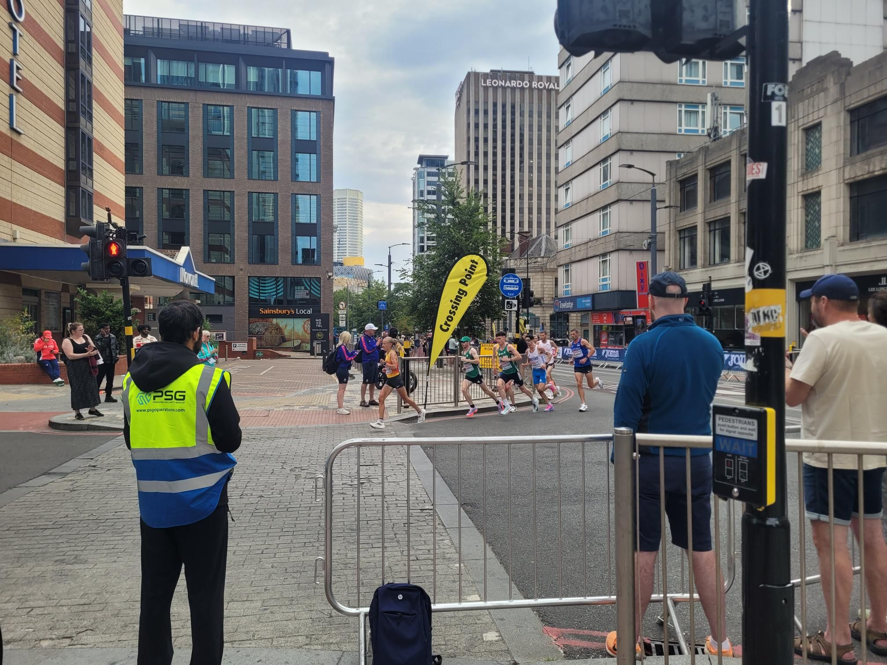

+++
title = "Reverse Harborne mile into maybe the Birmingham marathon?"
description = "Ride — 2026-08-16"
date = 2026-08-16
authors = ["Max Katz-Christy"]

[taxonomies]
tags = ["Ride"]

[extra]
banner = "banner.jpg"
strava_id = 19761858635
distance_fmt = "3.61 mi"
moving_time_fmt = "18m 22s"
elevation_gain_fmt = "85 ft"
+++

I did three laps on the little electric wedding train and explored the entire museum👍

## Stats

| | |
|---|---|
| **Distance** | 3.61 mi |
| **Moving time** | 18m 22s |
| **Elapsed time** | 19m 01s |
| **Elevation gain** | 85 ft |
| **Average speed** | 11.8 mph |

## Route

{{ strava_map() }}

[View on Strava](https://www.strava.com/activities/19761858635)

## Photos

