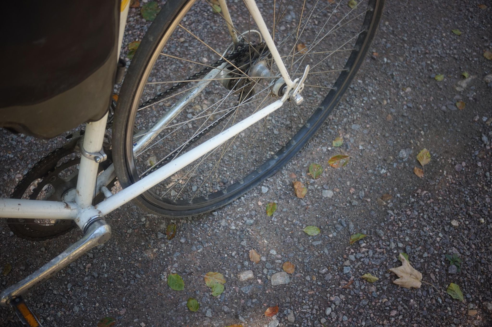

+++
title = "Flach ist schlimm"
description = "Hike — 2026-08-22"
date = 2026-08-22
authors = ["Max Katz-Christy"]

[taxonomies]
tags = ["Hike"]

[extra]
banner = "banner.jpg"
strava_id = 19850414475
distance_fmt = "6.66 mi"
moving_time_fmt = "1h 52m 48s"
elevation_gain_fmt = "427 ft"
+++

On the first decent of the day, after two minutes of pure bliss flying down a gravel road with my overnight gear strapped securely into my frame, I got a flat. Google maps said 2.5 hours on trails to Titisee, where there would at least be a train and hopefully a bike shop.

And... Turns out Fabio is back and is headed to Titisee as well coincidentally. In Titisee, the shops didn't have the right size tubes, and the water was inviting, so after a bit of enjoying the beach, we headed back on the train together for a little game night.

I also got a chance to change my rear tire. I find it very hard, mentally, to change a tire if you don't have a flat. So, this was a great opportunity for me. It can be hard to give up on your camping and biking plans, but if you allow yourself the freedom to do so easily, you lose much less than if you beat yourself up about it. No one is watching... Except a few dorks on Strava 🙃

## Stats

| | |
|---|---|
| **Distance** | 6.66 mi |
| **Moving time** | 1h 52m 48s |
| **Elapsed time** | 1h 55m 48s |
| **Elevation gain** | 427 ft |
| **Average pace** | 16:56 /mi |

## Route

{{ strava_map() }}

[View on Strava](https://www.strava.com/activities/19850414475)

## Photos

