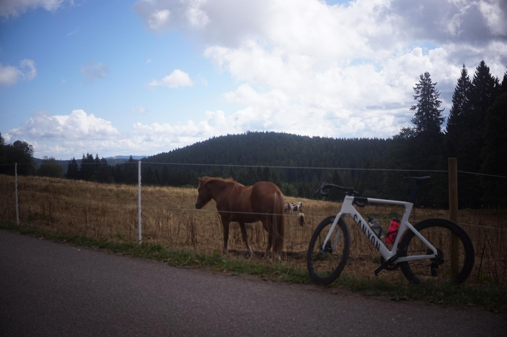

+++
title = "Steil ist geil"
description = "Ride — 2026-08-22"
date = 2026-08-22
authors = ["Max Katz-Christy"]

[taxonomies]
tags = ["Ride"]

[extra]
banner = "banner.jpg"
strava_id = 19848181968
distance_fmt = "15.84 mi"
moving_time_fmt = "1h 46m 52s"
elevation_gain_fmt = "3077 ft"
+++

Was told this as a way to remember the word for steep... However this was at the very end of the hearing for my bike. Met two very nice German guys at the top on their way to do a great Freiburg day loop which I plan to copy someday soon.

I woke up feeling sort of bored so I packed my hammock and lots of water onto my bike and headed out for a little overnight. Plan was to stop at the first bike shop and grab a spare tube...

## Stats

| | |
|---|---|
| **Distance** | 15.84 mi |
| **Moving time** | 1h 46m 52s |
| **Elapsed time** | 2h 07m 13s |
| **Elevation gain** | 3077 ft |
| **Average speed** | 8.9 mph |

## Route

{{ strava_map() }}

[View on Strava](https://www.strava.com/activities/19848181968)

## Photos

