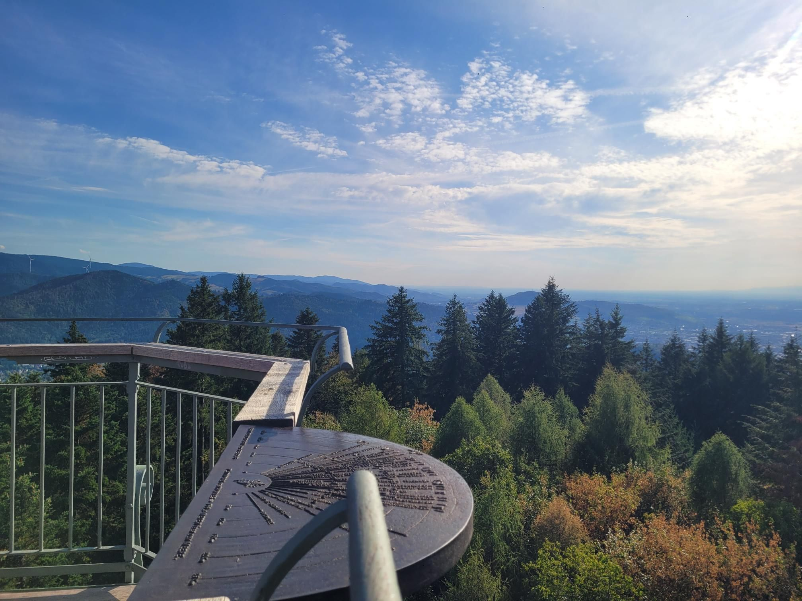

+++
title = "Finally did the whole baden to the bone"
description = "MountainBikeRide — 2026-08-23"
date = 2026-08-23
authors = ["Max Katz-Christy"]

[taxonomies]
tags = ["MountainBikeRide"]

[extra]
banner = "banner.jpg"
strava_id = 19867860150
distance_fmt = "12.30 mi"
moving_time_fmt = "1h 31m 43s"
elevation_gain_fmt = "1801 ft"
+++

Happy anniversary Jonathan Adler and Irene!

Nothing like a little backyard loop on one of the coolest trails I know with one of my favorite views in the area. Feeling ready for movie night, and maybe going to sleep before midnight 🤞

## Stats

| | |
|---|---|
| **Distance** | 12.30 mi |
| **Moving time** | 1h 31m 43s |
| **Elapsed time** | 1h 42m 24s |
| **Elevation gain** | 1801 ft |
| **Average speed** | 8.0 mph |

## Route

{{ strava_map() }}

[View on Strava](https://www.strava.com/activities/19867860150)

## Photos

