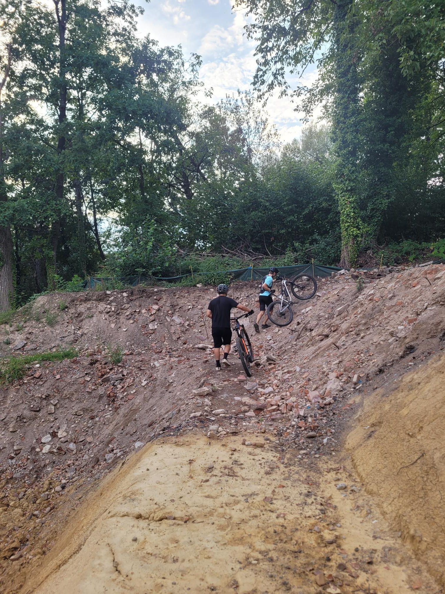

+++
title = "4 english accents"
description = "MountainBikeRide — 2026-08-24"
date = 2026-08-24
authors = ["Max Katz-Christy"]

[taxonomies]
tags = ["MountainBikeRide"]

[extra]
banner = "banner.jpg"
strava_id = 19882215452
distance_fmt = "9.26 mi"
moving_time_fmt = "1h 12m 38s"
elevation_gain_fmt = "1243 ft"
+++

American, British, Australian, and Badish. My coworker took me with his friends down a new trail I didn't know about!

Then we did some trespassing through a construction zone. Was not expecting that from the Germans.

## Stats

| | |
|---|---|
| **Distance** | 9.26 mi |
| **Moving time** | 1h 12m 38s |
| **Elapsed time** | 1h 29m 46s |
| **Elevation gain** | 1243 ft |
| **Average speed** | 7.6 mph |

## Route

{{ strava_map() }}

[View on Strava](https://www.strava.com/activities/19882215452)

## Photos

