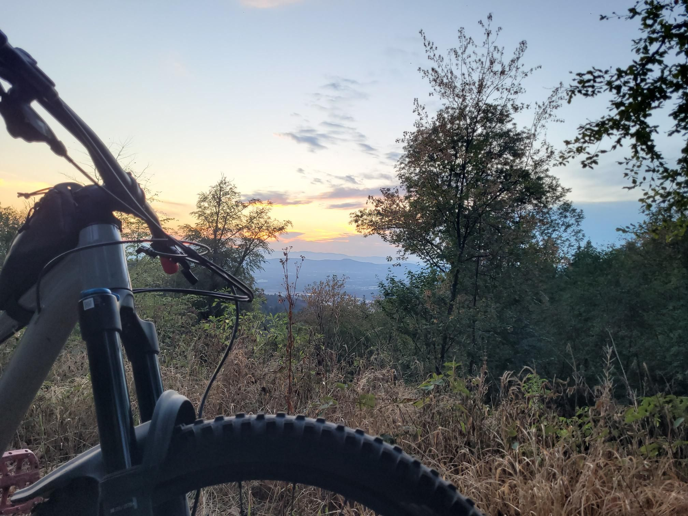

+++
title = "Until AI can drive buses..."
description = "MountainBikeRide — 2026-08-26"
date = 2026-08-26
authors = ["Max Katz-Christy"]

[taxonomies]
tags = ["MountainBikeRide"]

[extra]
banner = "banner.jpg"
strava_id = 19913738613
distance_fmt = "10.92 mi"
moving_time_fmt = "1h 08m 44s"
elevation_gain_fmt = "1490 ft"
+++

Got a call from Jolene at West Bus as the sun was setting and I popped out of Baden to the Bone on my MTB, fumbled the answer button but got a 10/10 voicemail transcript. Apparently it's been a rough summer up there in Downeast Maine for my favorite little bus. However... But they have GPS so maybe we can get them some live updates with realtime positions ok Google Maps!

## Stats

| | |
|---|---|
| **Distance** | 10.92 mi |
| **Moving time** | 1h 08m 44s |
| **Elapsed time** | 1h 16m 33s |
| **Elevation gain** | 1490 ft |
| **Average speed** | 9.5 mph |

## Route

{{ strava_map() }}

[View on Strava](https://www.strava.com/activities/19913738613)

## Photos

