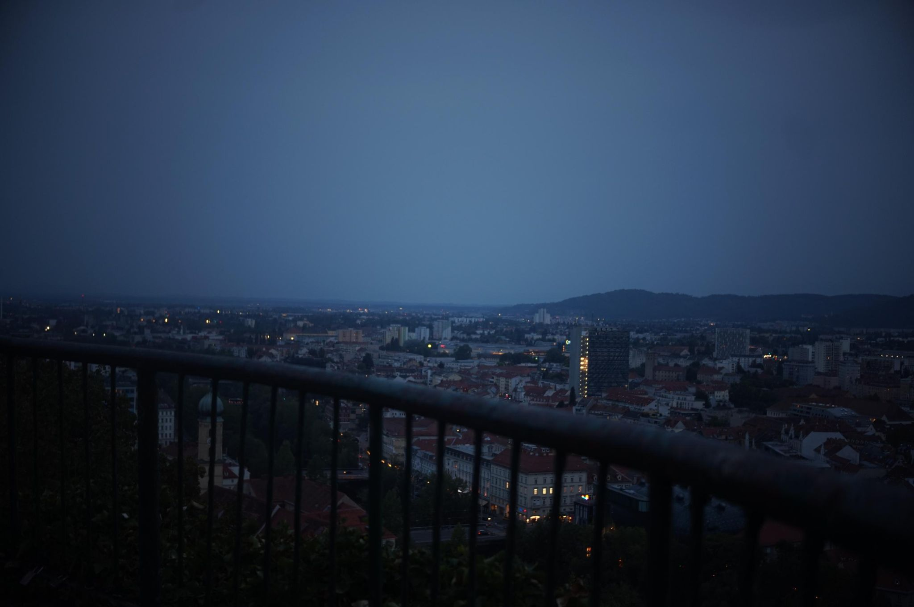

+++
title = "Fancy Schlossberg"
description = "Walk — 2026-08-28"
date = 2026-08-28
authors = ["Max Katz-Christy"]

[taxonomies]
tags = ["Walk"]

[extra]
banner = "banner.jpg"
strava_id = 19939899585
distance_fmt = "4.87 mi"
moving_time_fmt = "1h 42m 03s"
elevation_gain_fmt = "607 ft"
+++

We might have a beer garden on our Schlossberg in Freiburg, but the beer garden on this Schlossberg has a live DJ. Also has tunnels? At first I was a little jealous, but then it became a little overwhelming. Maybe I'm fine with our simple little no-frills Schlossberg.

Coming back to the station for my night train to Split, my train didn't make the board because it's all clogged up with delayed trains that should have departed 2h ago. And you might be thinking, you're not even in Germany, why is it all delayed? Don't worry, the announcements are sure to call all of the delays due to "international" circumstances 😉🥨

Got two pretty solid tgtg's, though both were a bit seafoody for being this far inland. I'll be at the real sea in the morning!

## Stats

| | |
|---|---|
| **Distance** | 4.87 mi |
| **Moving time** | 1h 42m 03s |
| **Elapsed time** | 2h 46m 41s |
| **Elevation gain** | 607 ft |
| **Average pace** | 20:57 /mi |

## Route

{{ strava_map() }}

[View on Strava](https://www.strava.com/activities/19939899585)

## Photos

