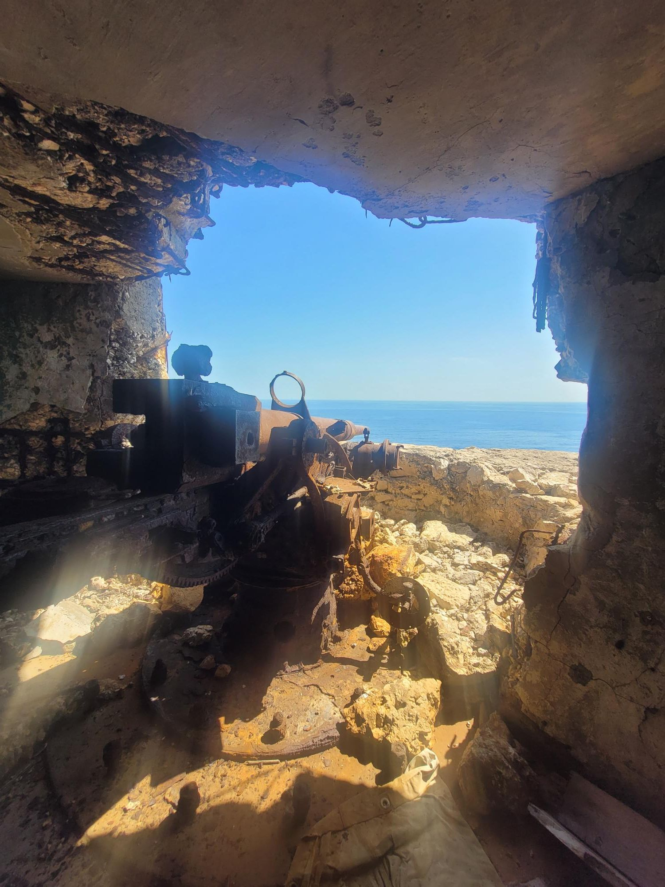

+++
title = "Cannanonplatz, Croatia edition"
description = "Hike — 2026-09-01"
date = 2026-09-01
authors = ["Max Katz-Christy"]

[taxonomies]
tags = ["Hike"]

[extra]
banner = "banner.jpg"
strava_id = 19989907703
distance_fmt = "8.05 mi"
moving_time_fmt = "2h 52m 36s"
elevation_gain_fmt = "837 ft"
+++

Nice hike up, we couldn't find the cannons at first... So I hiked around the coastline on my own. I found them and explored the bunkers behind until I felt like I wouldn't be able to remember the way out. On the way back to the trail, I realized that we had walked right past them and just not seen it over the edge.

## Stats

| | |
|---|---|
| **Distance** | 8.05 mi |
| **Moving time** | 2h 52m 36s |
| **Elapsed time** | 3h 40m 29s |
| **Elevation gain** | 837 ft |
| **Average pace** | 21:27 /mi |

## Route

{{ strava_map() }}

[View on Strava](https://www.strava.com/activities/19989907703)

## Photos

