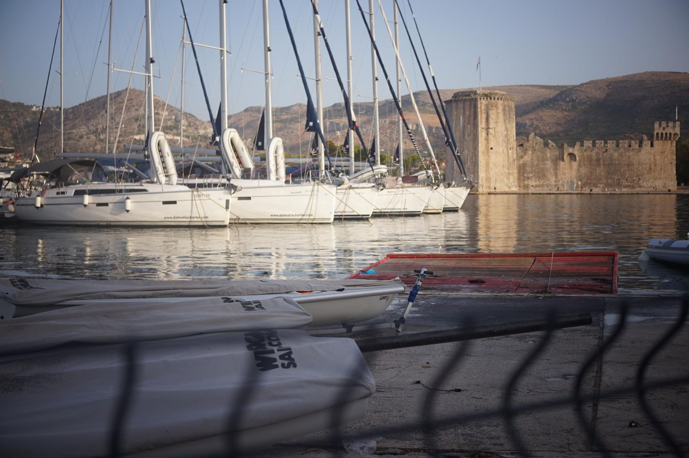

+++
title = "To the lil island"
description = "Swim — 2026-09-01"
date = 2026-09-01
authors = ["Max Katz-Christy"]

[taxonomies]
tags = ["Swim"]

[extra]
banner = "banner.jpg"
strava_id = 19986232326
distance_fmt = "1.28 km"
moving_time_fmt = "1h 04m 59s"
elevation_gain_fmt = "0 m"
+++

Apparently GPS doesn't work underwater

## Stats

| | |
|---|---|
| **Distance** | 1.28 km |
| **Moving time** | 1h 04m 59s |
| **Elapsed time** | 1h 04m 59s |
| **Elevation gain** | 0 m |
| **Average speed** | 1.2 km/h |

## Route

{{ strava_map() }}

[View on Strava](https://www.strava.com/activities/19986232326)

## Photos

