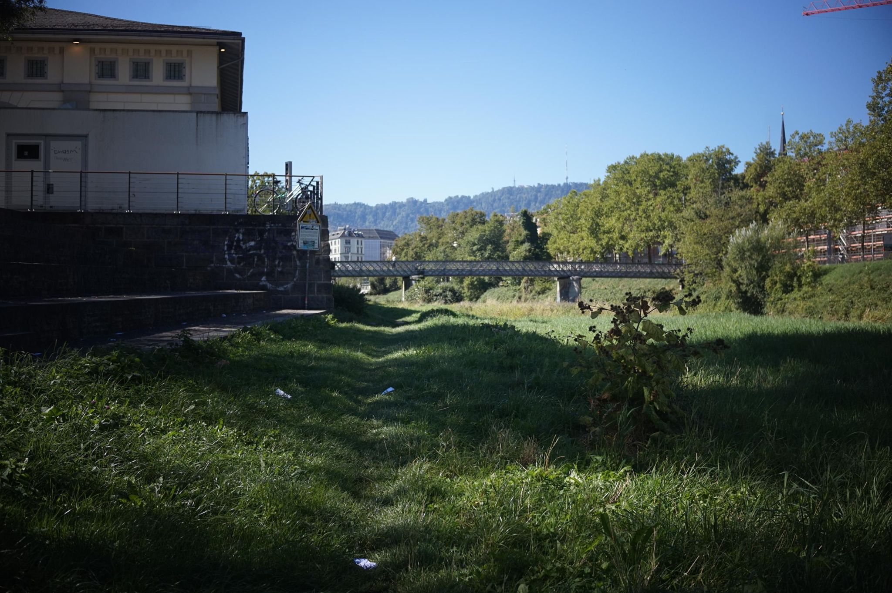

+++
title = "A new side of Zürich"
description = "Hike — 2026-09-06"
date = 2026-09-06
authors = ["Max Katz-Christy"]

[taxonomies]
tags = ["Hike"]

[extra]
banner = "banner.jpg"
strava_id = 20059740317
distance_fmt = "1.26 mi"
moving_time_fmt = "26m 27s"
elevation_gain_fmt = "164 ft"
+++

It's crazy that you can leave the station in one direction and get one vibe then leave in another and have a completely different feel for the city.

When I got back on Wi-Fi, I found an email with the subject "Trainfriends" from three guys living in Lausanne who I met in my cabin overnight. I guess they found my email. I played cards in the morning with three French Swiss guys from Neuchâtel... All I have is the badge number of one of them who works as a police officer. I guess I'll check for him at the station next time I'm there.

## Stats

| | |
|---|---|
| **Distance** | 1.26 mi |
| **Moving time** | 26m 27s |
| **Elapsed time** | 29m 22s |
| **Elevation gain** | 164 ft |
| **Average pace** | 21:01 /mi |

## Route

{{ strava_map() }}

[View on Strava](https://www.strava.com/activities/20059740317)

## Photos

