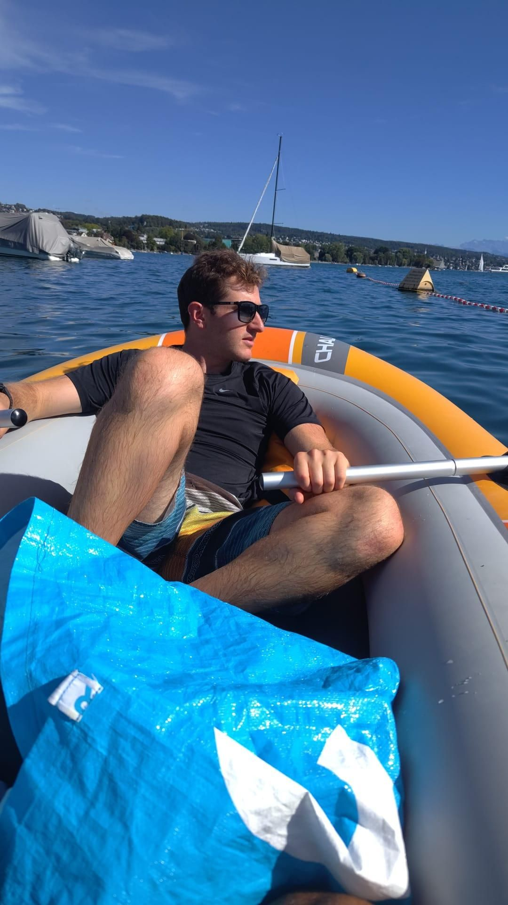

+++
title = "Nett hier"
description = "Canoeing — 2026-09-06"
date = 2026-09-06
authors = ["Max Katz-Christy"]

[taxonomies]
tags = ["Canoeing"]

[extra]
banner = "banner.jpg"
strava_id = 20064049738
distance_fmt = "1.46 mi"
moving_time_fmt = "57m 25s"
elevation_gain_fmt = "0 ft"
+++

Aber wären sie schon mal in Baden-Württemberg?

But nah it's actually pretty great here. Interesting to explore a bit more South.

## Stats

| | |
|---|---|
| **Distance** | 1.46 mi |
| **Moving time** | 57m 25s |
| **Elapsed time** | 1h 50m 58s |
| **Elevation gain** | 0 ft |
| **Average speed** | 1.5 mph |

## Route

{{ strava_map() }}

[View on Strava](https://www.strava.com/activities/20064049738)

## Photos

