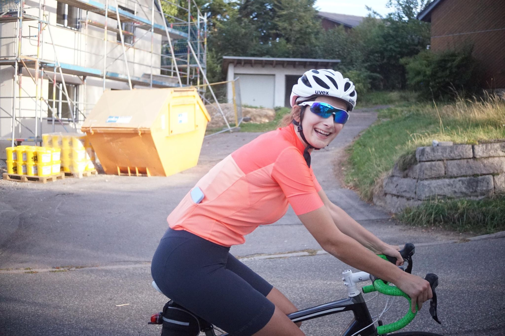

+++
title = "Lookin for alpacas"
description = "Ride — 2026-09-12"
date = 2026-09-12
authors = ["Max Katz-Christy"]

[taxonomies]
tags = ["Ride"]

[extra]
banner = "banner.jpg"
strava_id = 20149778244
distance_fmt = "17.06 mi"
moving_time_fmt = "1h 38m 16s"
elevation_gain_fmt = "1444 ft"
+++

Stelia T showed me a new route. Saw no alpacas. Next time to the vineyards.

Dropped my lens while trying to do a reverse lens shot and now the aperture ring is sticky... Maybe time for another lens repair. Glad I didn't buy a super expensive lens. I wonder if Caterpillar makes camera lenses...

## Stats

| | |
|---|---|
| **Distance** | 17.06 mi |
| **Moving time** | 1h 38m 16s |
| **Elapsed time** | 6h 25m 13s |
| **Elevation gain** | 1444 ft |
| **Average speed** | 10.4 mph |

## Route

{{ strava_map() }}

[View on Strava](https://www.strava.com/activities/20149778244)

## Photos

