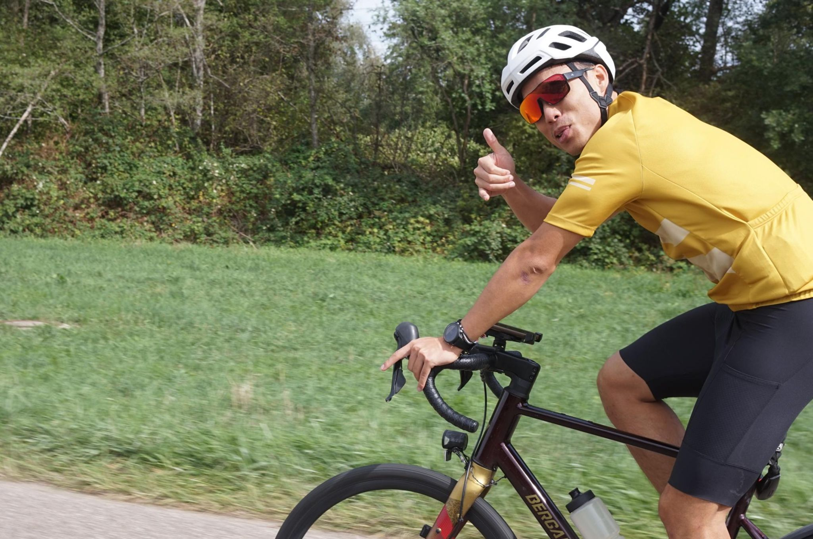

+++
title = "Country of vehicles"
description = "Ride — 2026-09-13"
date = 2026-09-13
authors = ["Max Katz-Christy"]

[taxonomies]
tags = ["Ride"]

[extra]
banner = "banner.jpg"
strava_id = 20160497631
distance_fmt = "44.30 mi"
moving_time_fmt = "3h 04m 52s"
elevation_gain_fmt = "2116 ft"
+++

Germany's got a lot of cars, but they seem to have a lot of bikes too. Beautiful suburbs, thanks Nam for the tour!

Sad to see all the dead corn... But the grapes seem to be more resilient.

## Stats

| | |
|---|---|
| **Distance** | 44.30 mi |
| **Moving time** | 3h 04m 52s |
| **Elapsed time** | 3h 45m 29s |
| **Elevation gain** | 2116 ft |
| **Average speed** | 14.4 mph |

## Route

{{ strava_map() }}

[View on Strava](https://www.strava.com/activities/20160497631)

## Photos

