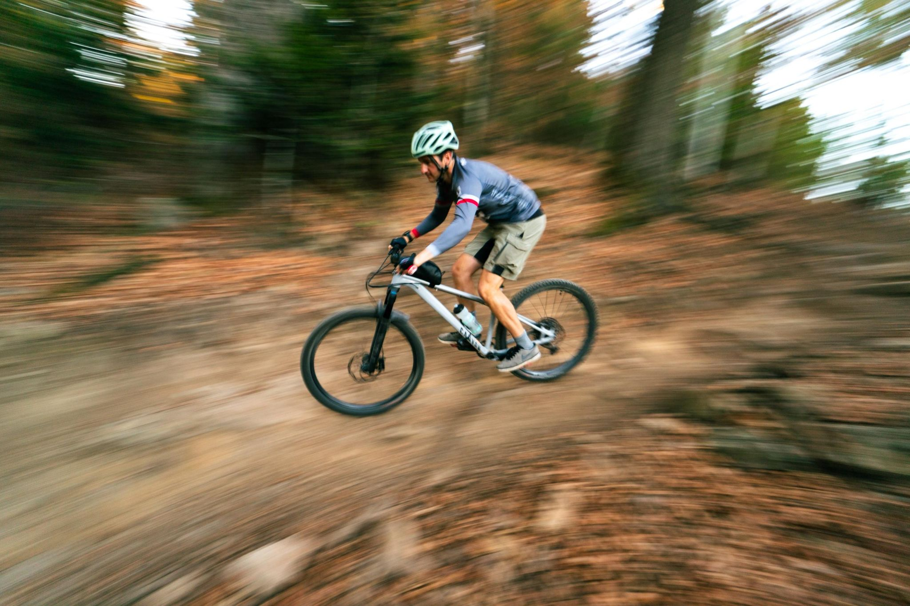

+++
title = "Brought my professional videographer along..."
description = "MountainBikeRide — 2026-09-14"
date = 2026-09-14
authors = ["Max Katz-Christy"]

[taxonomies]
tags = ["MountainBikeRide"]

[extra]
banner = "banner.jpg"
strava_id = 20175466207
distance_fmt = "12.00 mi"
moving_time_fmt = "1h 40m 16s"
elevation_gain_fmt = "1909 ft"
+++

I guess I didn't warn him how much we'd be going up... We ended up racing the sun on the way back down. Did some good recon though... Excited to go back soon and time the lighting better.

The last one is admittedly not me. However, I did the jump and I'm working on getting that kind of height.

Finn, the photographer who's really a videographer, also taught us a dice gambling game at a nice big Spielabend/game night I hosted. I've been away from the US for over a year now, and Freiburg is starting to really feel like home.

## Stats

| | |
|---|---|
| **Distance** | 12.00 mi |
| **Moving time** | 1h 40m 16s |
| **Elapsed time** | 2h 46m 21s |
| **Elevation gain** | 1909 ft |
| **Average speed** | 7.2 mph |

## Route

{{ strava_map() }}

[View on Strava](https://www.strava.com/activities/20175466207)

## Photos

