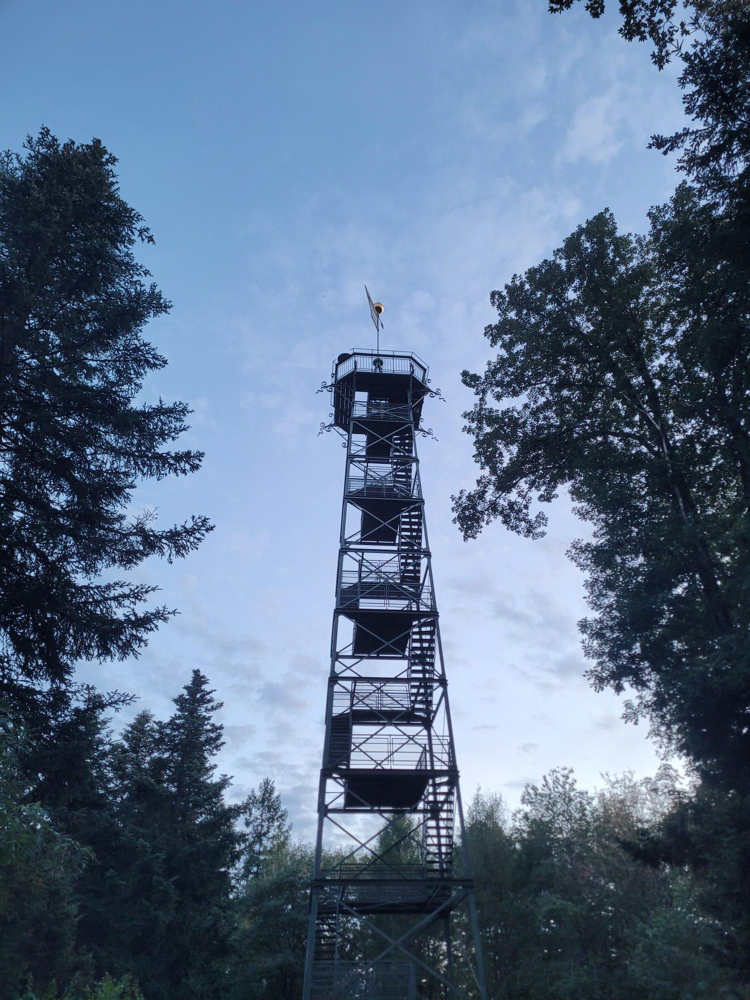

+++
title = "Good wifi and night trains"
description = "MountainBikeRide — 2026-09-17"
date = 2026-09-17
authors = ["Max Katz-Christy"]

[taxonomies]
tags = ["MountainBikeRide"]

[extra]
banner = "banner.jpg"
strava_id = 20217934924
distance_fmt = "11.21 mi"
moving_time_fmt = "1h 24m 42s"
elevation_gain_fmt = "1703 ft"
+++

If we had that everywhere in the world, no one would mind slow trains.

Maybe I'm getting boring, doing the same route again and again. It's great though. Just made it before sunset.

Looking forward to innotrans in Berlin with Jackson Moore-Otto

## Stats

| | |
|---|---|
| **Distance** | 11.21 mi |
| **Moving time** | 1h 24m 42s |
| **Elapsed time** | 1h 39m 22s |
| **Elevation gain** | 1703 ft |
| **Average speed** | 7.9 mph |

## Route

{{ strava_map() }}

[View on Strava](https://www.strava.com/activities/20217934924)

## Photos

