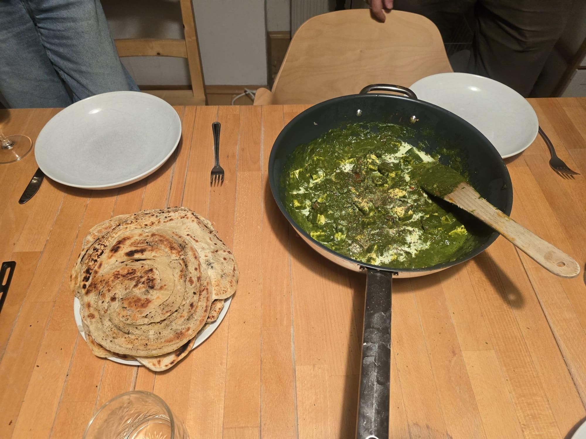

+++
title = "The Dutch are everywhere"
description = "Run — 2026-09-20"
date = 2026-09-20
authors = ["Max Katz-Christy"]

[taxonomies]
tags = ["Run"]

[extra]
banner = "banner.jpg"
strava_id = 20254242638
distance_fmt = "5.57 mi"
moving_time_fmt = "59m 21s"
elevation_gain_fmt = "361 ft"
+++

Also the Germans and Australiens. Would be interesting to see a map.

Had some fun making palak paneer last night with some friends, and playing some codenames. A bit tricky across language barries, very convenient to have English as my first language.

## Stats

| | |
|---|---|
| **Distance** | 5.57 mi |
| **Moving time** | 59m 21s |
| **Elapsed time** | 2h 00m 50s |
| **Elevation gain** | 361 ft |
| **Average pace** | 10:39 /mi |

## Route

{{ strava_map() }}

[View on Strava](https://www.strava.com/activities/20254242638)

## Photos

