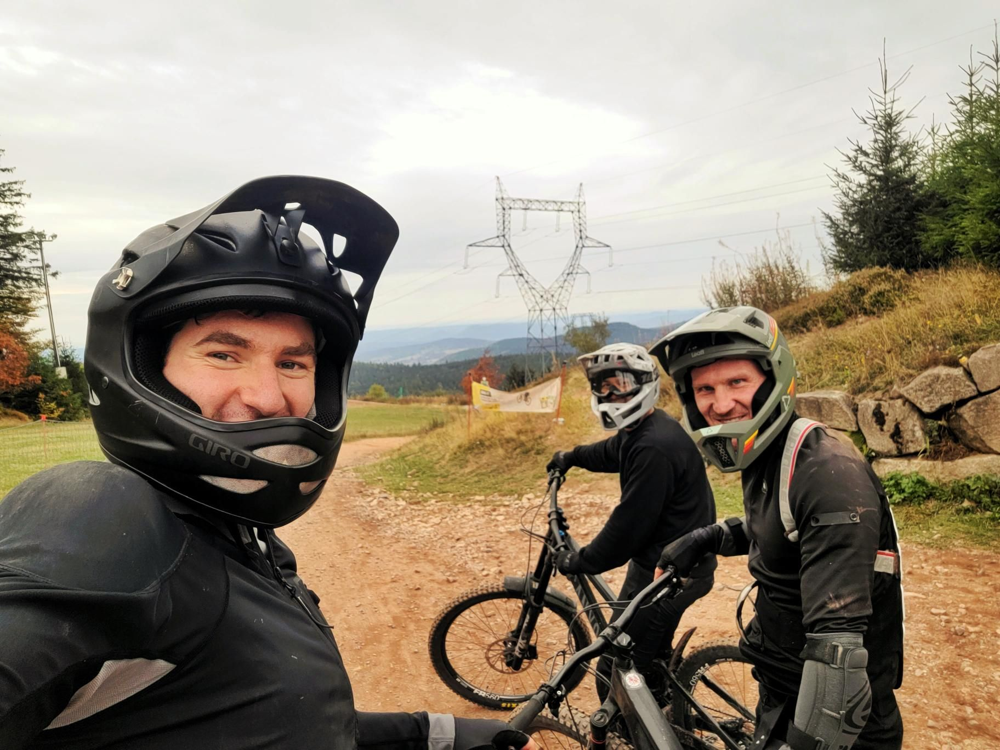

+++
title = "Following the smiley faces"
description = "MountainBikeRide — 2026-10-04"
date = 2026-10-04
authors = ["Max Katz-Christy"]

[taxonomies]
tags = ["MountainBikeRide"]

[extra]
banner = "banner.jpg"
strava_id = 20451173068
distance_fmt = "17.16 mi"
moving_time_fmt = "2h 11m 14s"
elevation_gain_fmt = "6818 ft"
+++

Every jump sign had a smiley face option, which allowed me to be happy. However, behind that smiling face, was feelings of lust to be able to fly off every jump and smile even more mixed with fear of flying off the jump and landing face first.

Went to the bike park with my coworker and his friend, who are both much better bikers than me. I noticed other groups with a similar pattern... One off the jump, two off the jump, third guy goes around. Maybe us scaredycats should get together and do something less dangerous.

By the end, I went back on some of the easier trails from the beginning and found them to be much more comfortable than before. Progress feels good, despite the pizza burn on my arm from one crash

## Stats

| | |
|---|---|
| **Distance** | 17.16 mi |
| **Moving time** | 2h 11m 14s |
| **Elapsed time** | 5h 37m 43s |
| **Elevation gain** | 6818 ft |
| **Average speed** | 7.8 mph |

## Route

{{ strava_map() }}

[View on Strava](https://www.strava.com/activities/20451173068)

## Photos

