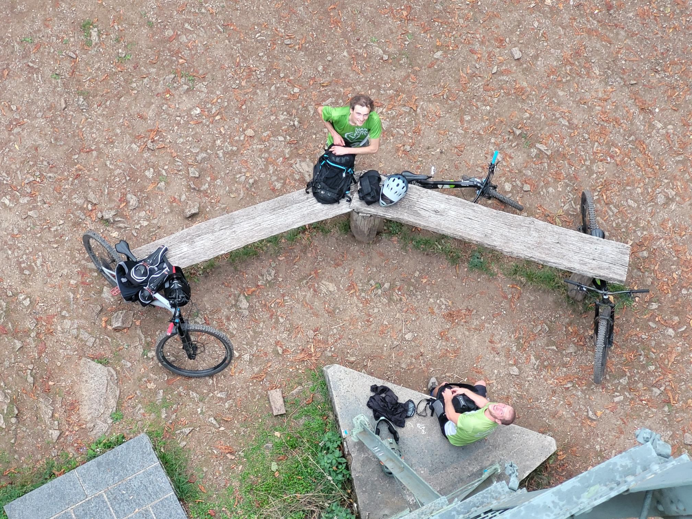

+++
title = "Flatted my 28.5\""
description = "MountainBikeRide — 2026-10-07"
date = 2026-10-07
authors = ["Max Katz-Christy"]

[taxonomies]
tags = ["MountainBikeRide"]

[extra]
banner = "banner.jpg"
strava_id = 20492243490
distance_fmt = "8.30 mi"
moving_time_fmt = "1h 20m 58s"
elevation_gain_fmt = "1696 ft"
+++

At the top had the classic metric vs imperial discussion, ended up chatting with some random guy about how Europeans call 700c 28.5... flatted right at the bottom and I'm walking home when the same guy offers me a 28.5 tube 😆

## Stats

| | |
|---|---|
| **Distance** | 8.30 mi |
| **Moving time** | 1h 20m 58s |
| **Elapsed time** | 2h 02m 06s |
| **Elevation gain** | 1696 ft |
| **Average speed** | 6.2 mph |

## Route

{{ strava_map() }}

[View on Strava](https://www.strava.com/activities/20492243490)

## Photos

