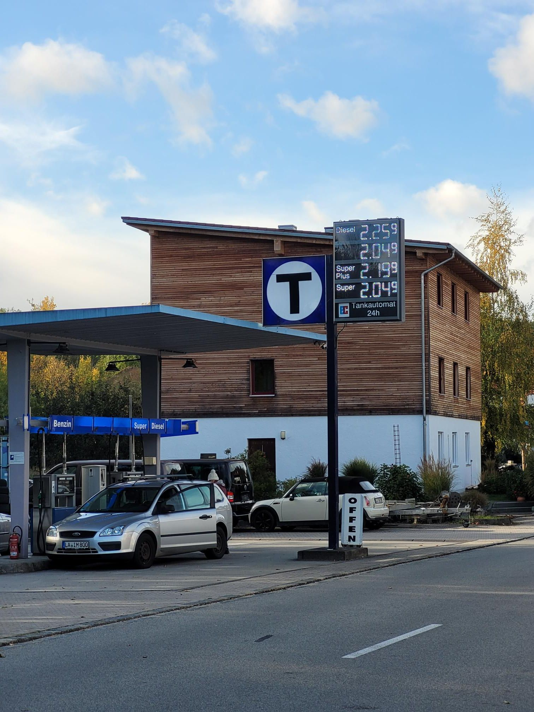

+++
title = "Pretty fun for an antisocial sport"
description = "Swim — 2026-10-26"
date = 2026-10-26
authors = ["Max Katz-Christy"]

[taxonomies]
tags = ["Swim"]

[extra]
banner = "banner.jpg"
strava_id = 20741280239
distance_fmt = "1.12 km"
moving_time_fmt = "46m 15s"
elevation_gain_fmt = "0 m"
+++

My French roommate invited me so I spontaneously took the plunge. Didn't have a towel, so I shook myself dry like a dog in the changing room. And... The pool is right next to my favorite tgtg and the cheap price is right at the tgtg pickup time. It's a sign from above 👼

Got back last night from Munich where I visited Elisa, who I sailed across the ocean with two years ago. Pretty crazy!

What's similar about this Bavarian gas station, Stockholm, and Boston?

## Stats

| | |
|---|---|
| **Distance** | 1.12 km |
| **Moving time** | 46m 15s |
| **Elapsed time** | 1h 16m 51s |
| **Elevation gain** | 0 m |
| **Average speed** | 1.5 km/h |

## Route

[View on Strava](https://www.strava.com/activities/20741280239)

## Photos

